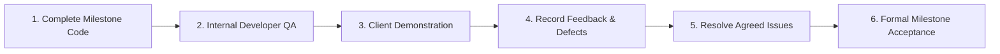

# HRMS Project — Milestone Plan and Delivery Schedule

## Document Metadata
- **Project:** Human Resource Management System (HRMS)
- **Client Organization:** Adhithiya Solutions
- **Source Document:** Software Requirements Specification (SRS) v1.1.0
- **Planned Project Duration:** 30 Calendar Days (Proposed Target)
- **Proposed Schedule:** October 28, 2026 – November 26, 2026
- **Document Status:** Proposed — Pending Client Review and Approval
- **Purpose:** Define the staged delivery plan, milestone deliverables, technical dependencies, acceptance criteria, and client review checkpoints for formal review and approval by the HR/client representative before commencing UI design and implementation.

*Important Note: All dates and durations in this document represent a targeted delivery schedule. The 30-calendar-day plan is conditional on timely written client approval of this milestone document, mutual agreement on project scope and acceptance criteria, and timely resolution of the business-rule dependencies identified herein. The schedule is a structured management target, not an unconditional guarantee of production readiness.*

---

## 1. Executive Summary

This Milestone Plan and Delivery Schedule establishes a structured, phased roadmap for developing and delivering the Human Resource Management System (HRMS) for **Adhithiya Solutions**. To manage implementation risks and ensure continuous stakeholder visibility within an ambitious 30-calendar-day target, the project is structured into **four sequential, verifiable milestones**.

The project covers three core functional domains—**Leave Management**, **Performance Management**, and **Payroll Management**—supported by cross-cutting **Access Control, Organizational Configuration, and System Audit Logging**. 

**Leave Management is designated as the first implementation priority (Milestone 1)** because it forms the logical foundation of organizational policies, employee self-service interactions, and manager approval hierarchies. Furthermore, downstream modules directly depend on leave data: attendance regularization reconciles against leave requests, and monthly payroll calculation mathematically depends on approved leave records to determine Loss of Pay (LOP) deductions.

Each milestone concludes with a dedicated **Client Demonstration Checkpoint**, scheduled on business working days (Fridays). These sessions allow the Adhithiya Solutions HR and management team to interact with working software, validate workflows against operational expectations, and record feedback. 

**Demonstration vs. Acceptance:** A milestone demonstration is strictly an interim review checkpoint and does **not** constitute or imply automatic milestone acceptance, especially if defects, open feedback items, or unresolved business dependencies remain. Formal milestone acceptance is recorded separately and only after verification that all acceptance criteria are met without blocking defects.

Unresolved business rules, statutory policies, and operational thresholds documented in SRS v1.4.0 are tracked in a dedicated dependencies section. These items must be confirmed through scheduled Knowledge Transfer (KT) sessions before they affect their respective implementation milestones. 

Formal completion and written client acceptance should be recorded at each milestone checkpoint before advancing to subsequent stages where dependencies exist. The schedule presented herein is proposed and subject to mutual agreement; it is not guaranteed or pre-approved.

---

## 2. Project Scope

The project scope is derived strictly from SRS v1.4.0 and encompasses the following functional domains:

### A. Foundation, Access Control, and Organization Settings
- **Core Architecture:** Centralized Monorepo containing the REST API backend and two purpose-built web portals: the **Employee Self-Service Portal** and the **Admin & Manager Portal**.
- **Role-Based Access Control (RBAC):** Three-tier authorization model:
  - *Super User (System Admin):* Full administrative governance, system configuration, Sub-User creation, audit inspection, and report generation.
  - *Sub-Users (HR / Department Managers):* Delegated administrative rights bounded by modular permission toggles and assigned departmental scopes.
  - *Users (Employees):* Self-service access restricted exclusively to personal profiles, leave requests, timesheets, assigned goals, appraisals, and payslips.
- **Super User Permission Builder:** Granular configuration of Sub-User rights via twelve distinct permission flags (`canManageEmployees`, `canApproveLeaves`, `canManageLeavePolicy`, `canAdjustLeaveBalances`, `canManageAttendance`, `canReviewProductivity`, `canManageGoals`, `canConfigureAppraisalParams`, `canManageAppraisals`, `canConfigureSalary`, `canProcessPayroll`, `canExportReports`).
- **Configurable Approval Hierarchies:** Multi-mode approval routing for leave and attendance regularization: Mode 1 (Direct Manager Only), Mode 2 (HR Only), or Mode 3 (Two-Stage: Manager $\rightarrow$ HR), with automatic fallback to HR/Super User when no manager is assigned.
- **Organization Settings (`FR-ORG`):** Company profile management, address, tax IDs, company logo (stamped on payslip PDFs), weekly-off schedule, and financial/leave year calendar boundaries.
- **Employee Directory:** Complete personnel records with employment details, bank/statutory numbers, and profile photo management.

### B. Leave Management
- **Stated Entitlements (Client Baseline Policy):**
  - **Sick Leave (SL):** 12 days annually, provisioned for all active employees by default.
  - **Casual Leave (CL):** 12 days annually, provisioned for all active employees by default.
  - **Earned Leave (EL):** 12 days annually (or assigned `earnedLeaveQuota`), applicable **only to eligible employees** where `isEligibleForEarnedLeave === true`. If the flag is `false`, the EL quota remains 0.
  - *Important Context:* These leave entitlement amounts reflect the client-stated baseline policy documented in SRS v1.4.0; they are not asserted as universal statutory mandates. Furthermore, while the database schema and UI support these baseline amounts, the initial allocation behavior (e.g. upfront annual credit on Jan 1 vs. monthly accrual of 1 day/month, and prorating for mid-year joiners) is subject to formal client confirmation in Dependency D2.
- **Dynamic Leave Type Builder:** Capability for the Super User to configure additional custom leave types (e.g., Maternity, Paternity, Bereavement, Comp-off), setting paid/unpaid status, annual quotas, and carry-forward limits.
- **Leave Application & Booking:** Online application form supporting full-day, multi-day, or half-day leaves with real-time balance validation.
- **Unified Balance Lifecycle (Reservation Model):**
  - *Submission:* Requested leave days are immediately **Reserved/Held** from available balance.
  - *Approval:* Reserved days transition to **Confirmed/Deducted**.
  - *Rejection / Pre-start Cancellation:* Reserved days are immediately **Released/Restored** back to available balance.
- **Holiday Calendar:** Centralized annual schedule of paid public holidays that are automatically excluded from leave duration counts.
- **Balance Adjustments & Auditability:** Super User and authorized HR Sub-Users can manually credit or debit balances, requiring a mandatory recorded audit reason.
- **Reports & Notifications:** Tabular leave utilization and balance reports (Excel/CSV export), in-app notification badges, and transactional SMTP email alerts for leave actions.
- *Unresolved Operational Rules (Marked TBD):* Accrual schedules (upfront annual vs. monthly accrual), mid-year joining prorating formulas, year-end carry-forward/encashment rules, and mandatory medical certificate upload thresholds.

### C. Attendance Management
- **Daily Attendance Capture (Milestone 2):** Employee 1-click Web Clock-In and Clock-Out capturing server timestamps.
- **Configurable Shift Rules:** System parameters for minimum working hours required for Full-Day credit (default: 8 hrs) vs. Half-Day credit (default: 4 hrs), and late-arrival grace periods (default: 15 mins).
- **Attendance Regularization (Milestone 2):** Self-service workflow for employees to submit missed-punch correction requests, routed through the configured approval hierarchy (Manager/HR).
- **Monthly Attendance Inputs & Reconciliation (Milestone 3):** Administrative input grid where HR reviews and confirms total working days, present days, paid leave days, and unpaid/absent days per employee for the pay period.
- **Attendance Source Precedence (`FR-ATT-005`):** Daily clock-in/out records and approved leave records automatically pre-fill the monthly attendance sheet. HR can confirm or manually override entries, with any override requiring a mandatory audit reason.
- **Absence Definition & Payroll Integration:** An "absence" is formally defined as a scheduled working day with no clock-in punch, no approved leave, and not a holiday or weekly off. Confirmed unpaid absences directly feed Loss of Pay (LOP) calculations.

### D. Performance Management
- **Daily Productivity Tracking:** Streamlined Daily Task Logger where employees record work date, project/category, task title, description, hours spent, status (*In Progress, Completed, Blocked*), and self-reported productivity notes, with same-day edits allowed until 23:59:59.
- **Manager Weekly Review & Coaching:** Department Managers inspect submitted team timesheets and assign weekly coaching ratings (1–5 scale) with narrative feedback.
- **Goal Setting & Tracking:** Employees and Managers set cycle goals with target dates, weights, and descriptions; employees update self-reported completion progress ($0\%$ to $100\%$) and milestones.
- **Appraisal Parameter Builder:** Super User configuration of custom evaluation parameters, competencies, rating scales (1–5), and weighting percentages summing to 100%.
- **Periodic Appraisal Workflow:** End-to-end appraisal cycle orchestration: HR cycle launch $\rightarrow$ Employee Self-Appraisal $\rightarrow$ Manager Review and Scoring $\rightarrow$ Super User Calibration and Final Sign-off.
- **Performance Reporting:** Exportable Weekly and Monthly Performance Reports aggregating logged hours, task completion rates, goal milestones, and appraisal ratings.

### E. Payroll Management
- **Configurable Salary Components:** Super User component builder supporting custom Earnings (Basic, HRA, Allowances, Bonuses) and Deductions (PF, ESI, Professional Tax, TDS, LOP).
- **Salary Structure Assignment:** Individualized monthly gross base salaries and component breakdowns assigned to employee profiles.
- **Attendance- and Leave-Linked Computation:** Automated calculation where approved paid leaves and public holidays are treated as fully payable days (zero deduction), and only confirmed unpaid/absent days incur Loss of Pay (LOP) deductions.
- **Pre-Payroll Review & Freeze:** Interactive administrative review grid for HR to inspect draft payroll figures, enter one-off adjustments (with mandatory audit reasons), and freeze the batch.
- **Vector PDF Payslips:** 1-click batch generation of branded, vector-quality PDF payslips via pure Node.js `PDFKit`, stamped with company logo, employee information, attendance summary, and itemized earnings/deductions.
- **Protected Distribution:** Secure streaming downloads accessible only by the respective employee and authorized administrators; automated batch email dispatch via SMTP.
- *Unresolved Payroll Rules (Marked TBD):* The exact per-day salary divisor policy (Actual Calendar Days $T_{cal}$ vs. Fixed 26 Days vs. Net Business Days $W_{std}$) and specific statutory contribution rates/ceilings. Option A (Actual Calendar Days) is used strictly as a temporary technical working assumption for initial development, not an approved payroll policy. Final calculation rules must be approved by HR and validated against sample test scenarios.

### F. Audit, Security, Testing, and Handover
- **Application Audit Log (`FR-AUDIT`):** Automated capture of actor, action, target entity, before/after values, reasons, and timestamps for critical operations (leave adjustments, approvals, permission changes, hierarchy updates, EL flag edits, attendance overrides, and payroll freeze).
- **Read-Only Audit Viewer:** Super User interface to inspect, search, and filter audit records without ability to edit or delete records.
- **Security & Authorization Hardening:**
  - *Authentication:* JWT cookie transmission (`HttpOnly`, `SameSite=Strict`), password hashing (`bcryptjs`, cost factor 12). Unauthenticated requests return **HTTP 401 Unauthorized**.
  - *Authorization:* Route guards verify roles and permissions. Unauthorized role access attempts (e.g. Employee accessing Admin routes) return **HTTP 403 Forbidden**.
  - *IDOR Prevention:* Explicit testing verifies that an authenticated Employee attempting to access, download, or stream another employee's payslip PDF (`/api/payroll/payslips/:id` or `/uploads/payslips/...`) or confidential records is blocked with **HTTP 403 Forbidden**.
  - *Rate-Limiting:* Login brute-force rate-limiting returning HTTP 429 after 10 failed attempts within 15 minutes.
- **Quality Assurance & Verification:** End-to-end integration testing, usability validation (3-click leave booking), and responsive UI verification.
- **Client Handover Package:** Complete monorepo source code, database ERD/schemas, automated seed scripts (`npm run seed`), deployment guide, and illustrated User Manuals (Employee and Admin).

---

## 3. Detailed Four-Milestone Schedule

The project is structured into four sequential milestones spanning a targeted 30 calendar days (October 28 – November 26, 2026).

```
Oct 28 ────────────────────── Nov 06 ────────────── Nov 13 ────────────── Nov 20 ────────────── Nov 26
  │                             │                     │                     │                     │
  ▼                             ▼                     ▼                     ▼                     ▼
[ M1: Foundation & Leave ]   [ M2: Performance & Att ] [ M3: Payroll & Recon ] [ M4: QA & Handover ]
   (10 Calendar Days)           (7 Calendar Days)         (7 Calendar Days)       (6 Calendar Days)
   Demo: Fri Nov 06             Demo: Fri Nov 13          Demo: Fri Nov 20        Sign-off: Thu Nov 26
```

---

### Milestone 1: Foundation, Access Control, and Leave Management

- **Proposed Schedule:** October 28, 2026 – November 06, 2026
- **Duration:** 10 Calendar Days
- **Milestone Scope & Functional Coverage:**
  - Monorepo project architecture (`server`, `admin-portal`, `employee-portal`, `shared-types`).
  - Database schemas, Mongoose models, and base seed scripts.
  - Authentication system with secure JWT tokens in `HttpOnly` cookies and password reset flows.
  - Three-tier Role-Based Access Control and Super User Permission Builder for Sub-Users (`FR-AUTH-005`).
  - Organization Settings (`FR-ORG`): Company name, address, tax IDs, logo upload, weekly-off schedule, and financial/leave year dates.
  - Employee profile management with `isEligibleForEarnedLeave` flag and `earnedLeaveQuota`.
  - Configurable Approval Hierarchy (1-Stage vs. 2-Stage modes with fallback).
  - Dynamic Leave Type Builder (`FR-LEAVE-002`) and standard quota allocations (12 SL, 12 CL, EL for eligible).
  - Leave application, duration calculation (excluding weekly offs from `FR-ORG` and holidays), and balance validation.
  - Unified Balance Lifecycle implementation (Reserved at submission $\rightarrow$ Confirmed upon approval $\rightarrow$ Released upon rejection/cancellation).
  - Manual leave balance adjustment with mandatory audit reasons logged to `FR-AUDIT-001`.
  - Annual Holiday Calendar creation and management.
  - Leave Utilization Reports (Excel/CSV export) and Holiday Schedule export (Web/PDF).
  - In-app notification badges and transactional SMTP email delivery for leave workflows (`FR-LEAVE-011`).
  - Audit-event capture for leave approvals, rejections, cancellations, balance adjustments, permission changes, and organization setting updates.

**Expected Deliverables:**
1. Initial working HRMS foundation and monorepo structure.
2. Authentication and role-based access workflows for Super User, Sub-Users, and Employees.
3. Employee directory and Organization Settings configuration interfaces.
4. Functional Leave Management self-service and administrative workflows.
5. Real-time leave balance cards and transaction history views.
6. Centralized Holiday Calendar interface.
7. Leave Utilization reporting (Excel and CSV exports) and Holiday Schedule PDF export.
8. Functional in-app and email notification dispatch for leave lifecycle events.
9. Audit-event capture active for leave and administrative actions.
10. Working demonstration build deployed for client inspection.

**Acceptance Criteria:**
- [ ] Super User, Sub-Users, and Employees can log in securely; JWTs are stored in `HttpOnly` cookies and inaccessible via JavaScript. Unauthenticated requests to protected endpoints return HTTP 401 Unauthorized.
- [ ] Attempting to access Admin Portal routes or restricted API endpoints (`/api/admin/*`) as an Employee returns HTTP 403 Forbidden.
- [ ] Super User can configure company profile, logo, weekly-off schedule, and year boundaries via Organization Settings (`FR-ORG-001`, `FR-ORG-002`).
- [ ] Super User can provision Sub-Users and toggle specific permission flags and departmental scopes.
- [ ] Super User can configure approval hierarchies (1-Stage Manager, 1-Stage HR, or 2-Stage Manager $\rightarrow$ HR).
- [ ] Super User can add and edit custom leave types with paid/unpaid status and quota limits.
- [ ] Leave allocation engine provisions leave balances according to the confirmed client policy; until Dependency D2 is formally resolved by HR, the system supports configurable upfront annual credit (12 SL, 12 CL) and `earnedLeaveQuota` for eligible employees (`isEligibleForEarnedLeave === true`), with final acceptance of allocation and mid-year prorating conditional on client confirmation.
- [ ] Leave requests reserve balance days immediately; duration calculations correctly exclude weekly offs and public holidays.
- [ ] Final leave approval converts reserved days to confirmed; rejection or pre-start cancellation releases days back to available balance.
- [ ] In-app notification badges and SMTP emails trigger accurately upon leave application, approval, and rejection.
- [ ] Manual balance adjustments require an audit reason and record a corresponding audit log entry.
- [ ] Holiday Calendar and Leave Utilization reports export cleanly to Excel, CSV, and PDF.

**Client Review Checkpoint:** Proposed demonstration on **Friday, November 06, 2026**.  
*Note: This demonstration is an interim review of working software. Formal milestone acceptance is recorded separately and only after verification that all acceptance criteria are met without blocking defects or unconfirmed dependencies.*

---

### Milestone 2: Performance Management and Daily Attendance

- **Proposed Schedule:** November 07, 2026 – November 13, 2026
- **Duration:** 7 Calendar Days
- **Milestone Scope & Functional Coverage:**
  - Daily Attendance Web Clock-In and Clock-Out interface capturing timestamps (`FR-ATT-002`).
  - System configuration for shift parameters: Full-Day hours threshold, Half-Day hours threshold, and late grace period.
  - Attendance Regularization workflow (`FR-ATT-003`) allowing employees to submit missed-punch corrections through the approval hierarchy.
  - Daily Task Logger (`FR-PROD-001`): Work date, project, task title, description, decimal hours, status, and self-reported productivity notes.
  - Timesheet submission validation (hours $>0$ and $\le 16$, same-day edits allowed until 23:59:59).
  - Departmental Timesheet Review console for Managers (`FR-PROD-003`).
  - Weekly Manager Rating (1–5 scale) and qualitative coaching feedback interface (`FR-PROD-004`).
  - Goal Setting module (`FR-PERF-001`): Goal creation, target dates, weights, progress updates ($0-100\%$), and manager review comments.
  - Appraisal Parameter Builder (`FR-PERF-002`): Custom competencies, evaluation parameters, rating scales (1–5), and weighting percentages summing to 100%.
  - Appraisal Cycle Orchestration (`FR-PERF-003`): Launching cycles, setting deadlines, and tracking submissions.
  - Structured Self-Appraisal form submission by employees (`FR-PERF-004`).
  - Manager Evaluation and scoring interface (`FR-PERF-005`).
  - Super User score calibration and final sign-off workflow (`FR-PERF-006`).
  - Exportable Weekly and Monthly Performance Reports (`FR-PERF-007`, `FR-REP-002`) to Excel and CSV.
  - Audit-event capture for attendance regularizations, appraisal parameter updates, score calibrations, and final sign-offs.

**Expected Deliverables:**
1. Daily Web Clock-In/Clock-Out and attendance status display.
2. Functional Attendance Regularization submission and approval workflow.
3. Daily Task Logger and timesheet entry forms.
4. Departmental Timesheet Review console with weekly rating (1–5 scale) and feedback fields.
5. Goal setting, milestone tracking, and progress percentage updates.
6. Appraisal Parameter Builder for competencies and weighted scoring rubrics.
7. Complete periodic appraisal cycle workflow (Self-review $\rightarrow$ Manager evaluation $\rightarrow$ Super User sign-off).
8. Formatted Weekly and Monthly Performance Reports (Excel and CSV exports).
9. Audit-event capture active for performance and attendance actions.
10. Working demonstration build deployed for client inspection.

**Acceptance Criteria:**
- [ ] Employees can record Clock-In and Clock-Out timestamps from the self-service dashboard.
- [ ] Employees can submit attendance regularizations; requests route through the configured approval chain (Manager/HR) and update attendance upon approval.
- [ ] Employees can submit daily task timesheets; entries validate hours and enforce same-day edit cutoffs.
- [ ] Managers can review team timesheets and submit weekly 1–5 ratings with coaching notes.
- [ ] Goals can be assigned and tracked with self-reported progress percentages ($0-100\%$).
- [ ] Super User can configure appraisal competencies, scales, and weights summing to 100%.
- [ ] Appraisal cycle can be launched; employee completes self-appraisal; manager completes evaluation; Super User signs off to publish the scorecard.
- [ ] Weekly and Monthly Performance Reports export accurately to Excel and CSV.
- [ ] Performance calibrations and attendance regularizations generate traceable audit records.
- *Pending Confirmation:* Shift timing rules and late-arrival thresholds remain conditional upon client confirmation of Dependency D8.

**Client Review Checkpoint:** Proposed demonstration on **Friday, November 13, 2026**.  
*Note: This demonstration is an interim review of working software. Formal milestone acceptance is recorded separately and only after verification that all acceptance criteria are met without blocking defects.*

---

### Milestone 3: Attendance Reconciliation and Payroll Management

- **Proposed Schedule:** November 14, 2026 – November 20, 2026
- **Duration:** 7 Calendar Days
- **Milestone Scope & Functional Coverage:**
  - Monthly Attendance Input Sheet (`FR-ATT-001`) displaying aggregated working days, present days, paid leaves, and unpaid LOP days.
  - Attendance Source Precedence (`FR-ATT-005`): Automated pre-fill from clock-in/out records and approved leaves, with mandatory audit reasons required for any manual HR override.
  - Formal absence aggregation (`FR-ATT-004`): Computing unpaid days from unregularized absences and approved unpaid leaves.
  - Salary Component Builder (`FR-PAY-001`): Dynamic configuration of Earnings (Basic, HRA, Allowances, Bonuses) and Deductions (PF, ESI, PT, TDS, LOP).
  - Salary Structure Assignment (`FR-PAY-002`): Assigning monthly gross base figures and component formulas to individual employees.
  - Unified Attendance- and Leave-Linked Salary Computation Engine (`FR-PAY-003`): Mathematical deduction of LOP days while preserving paid leaves and public holidays as fully payable (Section 5.2).
  - Pre-Payroll Review Grid (`FR-PAY-004`): Draft payroll inspection, one-off adjustment entries (with audit reasons), and payroll batch freeze.
  - Vector PDF Payslip Generator (`FR-PAY-005`): High-speed, pure Node.js `PDFKit` generation of branded payslips stamped with company logo (`FR-ORG-001`) and financial breakdown.
  - Protected local file storage in `/uploads/payslips/` with authenticated streaming routes (`FR-PAY-006`); unauthenticated access blocked with HTTP 401; cross-user IDOR access blocked with HTTP 403.
  - Automated batch email dispatch of payslips via SMTP (`FR-PAY-007`).
  - Monthly Payroll Reconciliation Sheet and Bank Disbursement Summary export to Excel (`.xlsx`) and CSV (`.csv`) (`FR-REP-004`).
  - Audit-event capture for attendance overrides, salary structure edits, payroll adjustments, and payroll batch freezes.

**Expected Deliverables:**
1. Monthly Attendance Reconciliation grid with automated pre-fill and override audit tracking.
2. Salary Component Builder and employee salary structure assignment screens.
3. Automated payroll calculation engine executing attendance- and leave-linked formulas.
4. Pre-payroll review and batch freeze console.
5. 1-Click vector PDF payslip generation engine stamped with company branding.
6. Secure payslip streaming and download interface for employees and administrators.
7. Batch email dispatcher for payslip notifications.
8. Monthly Payroll Reconciliation Sheet (Excel and CSV exports).
9. Audit-event capture active for all payroll and attendance operations.
10. Working demonstration build populated with client-approved sample payroll test cases.

**Acceptance Criteria:**
- [ ] Monthly attendance grid pre-fills from daily punches and approved leaves; manual overrides require and record an audit reason.
- [ ] Salary components and individualized salary structures can be created and assigned to employees.
- [ ] Approved paid leaves and public holidays are verified as fully payable days with zero deduction.
- [ ] Payroll engine calculates LOP deductions accurately against unapproved absences and unpaid leaves based on the configured daily divisor:
  $$\text{LOP Deduction} = \frac{\text{Monthly Gross Base}}{\text{Divisor Days}} \times D_{unpaid}$$
  *(Note: Option A is deployed as a temporary technical working assumption for initial development. Final acceptance of payroll calculations requires client confirmation of Dependency D10 and validation against sample test scenarios).*
- [ ] Pre-payroll grid allows authorized adjustments with audit logging and locks upon batch freeze.
- [ ] 1-Click payslip generation produces vector PDF payslips with company logo, employee details, and exact financial calculations matching sample cases.
- [ ] Direct unauthenticated HTTP requests to `/uploads/payslips/*` are blocked with HTTP 401 Unauthorized.
- [ ] Cross-employee IDOR security: Authenticated employees attempting to download or view another employee's payslip PDF are blocked with HTTP 403 Forbidden.
- [ ] Monthly Payroll Reconciliation Sheet exports cleanly to Excel and CSV.
- [ ] All payroll calculations match client-approved test scenarios.
- *Pending Confirmation:* Final sign-off on payroll figures is dependent upon client confirmation of the per-day salary divisor (Dependency D10) and statutory deduction parameters (Dependency D12).

**Client Review Checkpoint:** Proposed demonstration on **Friday, November 20, 2026**.  
*Note: This demonstration is an interim review of working software. Formal milestone acceptance is recorded separately and only after verification that all acceptance criteria are met without blocking defects.*

---

### Milestone 4: Integration, Quality Assurance, Security, and Handover

- **Proposed Schedule:** November 21, 2026 – November 26, 2026
- **Duration:** 6 Calendar Days
- **Milestone Scope & Functional Coverage:**
  - End-to-end integration and data flow verification across all modules (Leave $\rightarrow$ Attendance $\rightarrow$ Performance $\rightarrow$ Payroll).
  - System Audit Log Viewer (`FR-AUDIT-002`): Read-only administrative viewer with multi-criteria search and filtering by date, actor, action, and entity.
  - Cross-module audit trail verification ensuring all critical operations produce immutable audit records.
  - Comprehensive security audit:
    - Unauthenticated requests to protected endpoints return HTTP 401 Unauthorized.
    - Route authorization guards verifying that Employees cannot access Admin routes (HTTP 403 Forbidden).
    - Unauthenticated file download prevention on `/uploads/` (HTTP 401 Unauthorized).
    - Insecure Direct Object Reference (IDOR) prevention blocking cross-employee data/payslip access (HTTP 403 Forbidden).
    - Authentication brute-force rate-limiting returning HTTP 429 after 10 failed login attempts.
  - Usability validation: Verifying that newly onboarded employees can submit a leave request in 3 clicks or fewer from the dashboard without training.
  - Responsive UI verification across desktop (1280px+), tablet (768px–1024px), and mobile (375px+) viewports.
  - Bug fixing, edge-case resolution, and performance tuning (verifying sub-300ms API reads and sub-45s batch payslip generation).
  - Preparation and verification of client handover deliverables: source code monorepo, database schemas, seed scripts, deployment documentation, and User Manuals.
  - Client User Acceptance Testing (UAT) review and final handover sign-off.

**Expected Deliverables:**
1. Fully integrated, hardened HRMS application (Employee Portal, Admin Portal, and REST API).
2. Functional, read-only System Audit Log Viewer interface.
3. Test execution summary, security audit report, and defect resolution log.
4. Clean, documented source code repository with semantic git commit history.
5. Database Entity-Relationship Diagram (ERD), schema definitions, and automated seed script (`npm run seed`).
6. Production environment configuration guide and `.env.example` templates.
7. Illustrated **Employee User Manual** (PDF/Markdown).
8. Illustrated **Admin & Manager User Manual** (PDF/Markdown).
9. Complete API Collection (Postman / Bruno).
10. Final Project Handover and Acceptance Checklist.

**Acceptance Criteria:**
- [ ] End-to-end workflows operate seamlessly across Leave, Attendance, Performance, and Payroll modules.
- [ ] Super User can access the read-only Audit Log Viewer to search and filter recorded events with before/after values and timestamps.
- [ ] Security checks pass: HTTP 401 on unauthenticated requests, HTTP 403 on restricted admin routes, HTTP 403 on cross-user IDOR attempts, and HTTP 429 on brute-force login attempts.
- [ ] Usability validation confirms a new employee can submit a leave request in 3 clicks or fewer from the home dashboard.
- [ ] User interface displays responsively across mobile, tablet, and desktop viewports without broken layouts.
- [ ] All critical and high-severity defects identified during milestone testing are resolved or documented with an agreed resolution plan.
- [ ] All required documentation, seed scripts, database schemas, and source code packages are delivered in accordance with handover specifications.
- [ ] The client formally reviews handover deliverables and records acceptance or outstanding items.

**Final Review and Handover Checkpoint:** Proposed final handover sign-off on **Thursday, November 26, 2026**.

---

## 4. Milestone Summary Table

The table below summarizes the four proposed project milestones. The schedule spans a targeted 30 calendar days sequentially without gaps or overlaps.

| Milestone # | Milestone Name | Proposed Start Date | Proposed End Date | Duration (Days) | Major Deliverables | Review Checkpoint | Status |
| :---: | :--- | :---: | :---: | :---: | :--- | :---: | :---: |
| **Milestone 1** | **Foundation, Access Control & Leave Management** | Oct 28, 2026 | Nov 06, 2026 | 10 Days | Foundation, Auth, RBAC Permission Builder, Org Settings, Leave Module, Holiday Cal, Balance Engine, Leave Reports & Notifications. | Fri, Nov 06, 2026 (Demo) | **Proposed** |
| **Milestone 2** | **Performance Management & Daily Attendance** | Nov 07, 2026 | Nov 13, 2026 | 7 Days | Daily Clock-In/Out, Attendance Regularization, Task Timesheet Logger, Weekly Manager Review, Goal Setting, Appraisal Cycles & Reports. | Fri, Nov 13, 2026 (Demo) | **Proposed** |
| **Milestone 3** | **Attendance Reconciliation & Payroll Management** | Nov 14, 2026 | Nov 20, 2026 | 7 Days | Attendance Precedence Sheet, Salary Component Builder, Unified Payroll Engine, Vector PDF Payslips, Bank Export Sheets. | Fri, Nov 20, 2026 (Demo) | **Proposed** |
| **Milestone 4** | **Integration, QA, Security & Handover** | Nov 21, 2026 | Nov 26, 2026 | 6 Days | System Integration, Read-Only Audit Viewer, Security Hardening, Usability Tests, User Manuals, Code & DB Handover. | Thu, Nov 26, 2026 (Sign-off) | **Proposed** |
| **TOTAL** | **Full HRMS Project Lifecycle** | **Oct 28, 2026** | **Nov 26, 2026** | **30 Days** | **Complete Dual-App HRMS Suite & Handover Assets** | **Nov 26, 2026** | **Proposed Target** |

*Note: Dates and review checkpoints are proposed targets. A milestone demonstration does not constitute automatic acceptance; acceptance is recorded separately upon verification of acceptance criteria and closure of dependencies.*

---

## 5. Client Clarifications and Business-Rule Dependencies

The following table itemizes the business rules, statutory policies, and operational decisions identified in SRS v1.4.0 that require formal client confirmation. Deliverables and acceptance criteria dependent on these items will operate on temporary baseline technical assumptions until confirmed.

| Ref # | Decision / Clarification Required | Why It Matters (Impact on Development) | Milestone Affected | Status in SRS v1.4.0 | Required Confirmation Date |
| :---: | :--- | :--- | :---: | :---: | :---: |
| **D1** | **Leave Year & Financial Year Boundaries** | Determines the annual cycle for leave balance resets, holiday calendars, and tax/payroll reporting periods. | Milestone 1 | Pending Client Confirmation (Configurable via `FR-ORG-002`) | To be agreed with client |
| **D2** | **Leave Accrual & Mid-Year Prorating Rules** | Governs whether SL/CL are credited upfront (12 days on Jan 1) or accrued monthly (1 day/month), and the exact formula for mid-year joiners. Acceptance of leave allocation logic is conditional on this decision. | Milestone 1 | Pending Client Confirmation (Open Question Q2) | To be agreed with client |
| **D3** | **Joining Month Leave Eligibility Rules** | Dictates whether employees joining after a specific day of the month (e.g., 15th) receive leave credits for that calendar month. | Milestone 1 | Pending Client Confirmation | To be agreed with client |
| **D4** | **Earned Leave (EL) Eligibility Criteria & Quota** | Establishes the exact conditions qualifying an employee for EL (e.g., probation completion vs. 12 months service) and whether quotas vary. | Milestone 1 | Pending Client Confirmation (Open Question Q7; default: 12 days via `earnedLeaveQuota`) | To be agreed with client |
| **D5** | **Leave Carry-Forward & Encashment Policies** | Governs year-end balance processing: whether unused SL/CL/EL lapse on Dec 31, carry forward (with caps), or are encashable upon exit. | Milestone 1 | Pending Client Confirmation (Open Question Q3) | To be agreed with client |
| **D6** | **Medical Certificate Upload Thresholds** | Determines whether medical documentation is mandatory when Sick Leave exceeds a specific consecutive duration (e.g., $\ge 3$ days). | Milestone 1 | Pending Client Confirmation | To be agreed with client |
| **D7** | **Pending Leave Reservation & Release Behavior** | Confirms whether the reservation model (holding days at submission, confirming on approval, releasing on rejection) meets all HR needs. | Milestone 1 | Proposed in SRS v1.4.0 (`FR-LEAVE-005`) | To be agreed with client |
| **D8** | **Shift Timings, Grace Periods & Absence Rules** | Defines standard working hours, late-arrival grace window (minutes), and threshold hours required for Half-Day vs. Full-Day credit. | Milestone 2 | Pending Client Confirmation (Open Question Q6; configurable) | To be agreed with client |
| **D9** | **Authoritative Attendance Precedence Rules** | Confirms the business rule that daily clock-in records pre-fill the monthly sheet and manual HR overrides require mandatory audit reasons. | Milestone 3 | Proposed in SRS v1.4.0 (`FR-ATT-005`) | To be agreed with client |
| **D10** | **Per-Day Salary Divisor Policy** | Selects the divisor used to compute daily salary rates for LOP deductions: Option A (Actual Calendar Days), Option B (26 Days), or Option C (Working Days). Option A is a temporary technical working assumption only; final policy must be confirmed by HR and validated against sample test cases. | Milestone 3 | Pending Client Confirmation (Open Question Q4) | To be agreed with client |
| **D11** | **Leave and Holiday Treatment in Payroll** | Confirms that approved paid leaves ($L_{paid}$) and public holidays ($H_{pub}$) are fully payable days with zero deduction, and only unpaid days incur LOP. | Milestone 3 | Proposed in SRS v1.4.0 (Section 5.2) | To be agreed with client |
| **D12** | **Statutory Deductions & Slab Configuration** | Identifies specific organizational deduction rates/slabs for Provident Fund (PF), ESI, Professional Tax (PT), and TDS/Income Tax withholding. | Milestone 3 | Pending Client Confirmation (Open Question Q5; configurable) | To be agreed with client |
| **D13** | **Approval Hierarchy Scope & Departmental Rules** | Confirms whether standard 1-Stage or 2-Stage approval chains are sufficient or if department-specific/3+ stage chains are required. | Milestone 1 | Pending Client Confirmation (Open Question Q1; baseline: 1-to-2 stage) | To be agreed with client |
| **D14** | **SMTP Email Server Credentials & Expectations** | Required for dispatching transactional email notifications for leave workflows and monthly payslip PDF attachments. | Milestone 1 & 3 | Technical Dependency | To be agreed with client |
| **D15** | **Confirmation of 30-Day Timeline & Acceptance Criteria** | Formal alignment between Adhithiya Solutions stakeholders and the engineering team on the proposed milestone schedule and criteria. | All Milestones | Proposed Baseline | To be agreed with client |

---

## 6. Assumptions, Risks, and Mitigation Strategies

The risk assessment below identifies technical, operational, and scheduling risks based on SRS v1.4.0 along with proactive mitigation strategies.

| Risk Description | Impact on Project | Proactive Mitigation Strategy | Affected Milestone(s) |
| :--- | :---: | :--- | :---: |
| **Ambitious 30-Day Targeted Timeline for Comprehensive Scope** | High | Scope is strictly prioritized into staged milestones; Leave Management is completed first. Pre-built accessible UI primitives (Radix UI / Tailwind CSS) and pure Node vector PDF generators are utilized to avoid heavy third-party scaffolding. Delivery dates represent a target conditional on dependency closure. | All Milestones (M1 – M4) |
| **Delayed Client Clarification on Unresolved Rules** | High | System architecture uses configurable parameter builders (dynamic leave types, configurable salary components, adjustable divisor). Temporary technical working assumptions are deployed; changing a policy requires administrative configuration rather than code refactoring. | Milestone 1 & Milestone 3 |
| **Complexity in Payroll & LOP Calculation Validation** | High | The unified mathematical formula (Section 5.2) is deployed with temporary working assumptions. Milestone 3 incorporates a dedicated demonstration using client-approved sample calculation cases to reconcile discrepancies before final acceptance. | Milestone 3 |
| **Discrepancies Between Attendance Logs and Leaves** | Medium | Milestone 2 establishes attendance capture and regularization workflows; Milestone 3 implements attendance precedence (`FR-ATT-005`) ensuring leaves and punches reconcile cleanly before payroll execution. | Milestone 2 & Milestone 3 |
| **SMTP Mail Server Configuration Delays** | Medium | The notification engine is architected with dual channels: real-time in-app notification badges function independently of external mail servers. SMTP credentials can be configured via environment variables at any point without blocking workflows. | Milestone 1 & Milestone 3 |
| **Persistent Storage & File Backup on Local Server** | Medium | Local `/uploads` storage eliminates third-party cloud costs. The deployment package includes automated backup utility scripts (`mongodump` and file sync) and Express route security preventing unauthorized downloads. | Milestone 1, 3 & 4 |
| **Integration and Cross-Module Defect Discovery in Final Sprint** | Medium | Testing is conducted incrementally at the conclusion of each milestone demo rather than deferred entirely to the final week. Milestone 4 focuses strictly on regression, security verification, and documentation. | Milestone 4 |
| **Schedule Slip Risk on Administrative Hierarchies & Reports** | Medium | **No unilateral scope reduction:** If development velocity indicates a risk of schedule slippage during Milestones 1 or 3, any proposed scope adjustment, feature simplification, or milestone timeline revision requires formal written review and mutual agreement with the client under Section 9.2 Change Control; no agreed requirement will be downgraded unilaterally. | Milestone 1 & Milestone 3 |

---

## 7. Audit and Security Delivery Strategy

System audit logging and security protections are implemented incrementally alongside feature development rather than postponed to the final testing phase:

```
┌────────────────────────────────────────────────────────────────────────┐
│                   INCREMENTAL AUDIT & SECURITY ROADMAP                 │
├────────────────────────────────────────────────────────────────────────┤
│ MILESTONE 1:                                                           │
│ • Secure JWT in HttpOnly cookies, bcryptjs password hashing            │
│ • HTTP 401 guard on unauthenticated access; HTTP 403 on admin routes   │
│ • Capture audit events: Leave balance adjustments, approvals,          │
│   rejections, cancellations, permission changes, and org settings      │
│                                                                        │
│ MILESTONE 2:                                                           │
│ • Attendance regularization audit events                               │
│ • Performance appraisal parameter edits, score calibrations, sign-offs │
│                                                                        │
│ MILESTONE 3:                                                           │
│ • Monthly attendance manual override audit events with reasons         │
│ • Salary structure assignment, pre-payroll adjustments, batch freeze   │
│ • HTTP 401 streaming guards on /uploads/payslips/                      │
│ • HTTP 403 IDOR prevention blocking cross-employee payslip access      │
│                                                                        │
│ MILESTONE 4:                                                           │
│ • System Audit Log Viewer (`FR-AUDIT-002`) in Admin Portal (read-only) │
│ • Brute-force rate limiting (HTTP 429 after 10 failed attempts)        │
│ • End-to-end audit verification and cross-module security review       │
└────────────────────────────────────────────────────────────────────────┘
```

- **Application-Level Immutability:** In accordance with `FR-AUDIT-001` and `FR-AUDIT-002`, audit records capture Actor ID, Action, Target Entity, Before/After values, Reason, IP, and Timestamp. The application interface provides strictly read-only views with no update or delete endpoints. (Note: This guarantees application-level integrity; it does not claim cryptographic hardware immutability against direct database administrator access).

---

## 8. Review, Demonstration, and Acceptance Process

To maintain alignment and formal progress tracking, each milestone follows a standardized six-step review and acceptance workflow:



1. **Deliverable Completion:** The engineering team completes development of all functional and technical requirements assigned to the milestone.
2. **Internal Developer QA:** Features are verified against unit tests, route security checks, and specific milestone acceptance criteria.
3. **Client Demonstration:** A formal demonstration build is presented to the Adhithiya Solutions client/HR representative on the scheduled review date (Fridays).
4. **Feedback & Defect Recording:** Stakeholders review working software against operational expectations. Feedback, observations, and identified defects are documented in a shared review register.
5. **Issue Resolution & Prioritization:** Agreed defects and blocking issues are resolved or scheduled with clear priority before subsequent dependencies are built.
6. **Milestone Acceptance:** The client representative and project lead record formal milestone sign-off.

> **Important Distinction:** A milestone demonstration is strictly an interim review checkpoint and does **not** constitute or imply automatic milestone acceptance. Formal milestone acceptance is recorded only when the client confirms that deliverables satisfy agreed acceptance criteria, all critical defects are resolved or scheduled, and required business dependencies are closed. Scope changes or alterations to previously agreed requirements must be formally evaluated under change control before implementation.

---

## 9. Out of Scope and Change Control

### 9.1 Excluded Features (Derived from SRS v1.4.0, Section 11.3)
The following items are explicitly excluded from the 30-day implementation scope:
1. **Native Mobile Applications:** Native iOS or Android mobile binary apps (`.ipa` / `.apk`). The web application portals are built with responsive layouts supporting mobile browser viewports (minimum 375px).
2. **Direct Hardware Biometric Machine Firmware Integration:** Real-time TCP/IP socket polling or direct firmware communication with physical biometric punch machines. Attendance data is ingested via web clock-in/out or structured manual reconciliation grids.
3. **Government Statutory Tax Portal E-Filing:** Automated electronic filing or direct API integration with government portals (e.g., EPFO, ESIC, or Income Tax Department filing portals).
4. **Direct-to-Bank Gateway Payment Disbursements:** Automated live bank disbursement via direct NEFT/RTGS payment gateway APIs. Bank disbursements are facilitated via exportable Bank Payment Reconciliation spreadsheets.

### 9.2 Change Control Policy
No additional exclusions have been assumed in this milestone document. Any proposed scope additions, workflow modifications, scope simplifications, or deviations from SRS v1.4.0 must be reviewed jointly by Adhithiya Solutions and the development team. If an approved change impacts architecture, technical dependencies, or delivery timelines, the milestone schedule and delivery commitments shall be adjusted accordingly through a written addendum signed by both parties. No agreed requirement or scope item will be modified or removed unilaterally.

---


