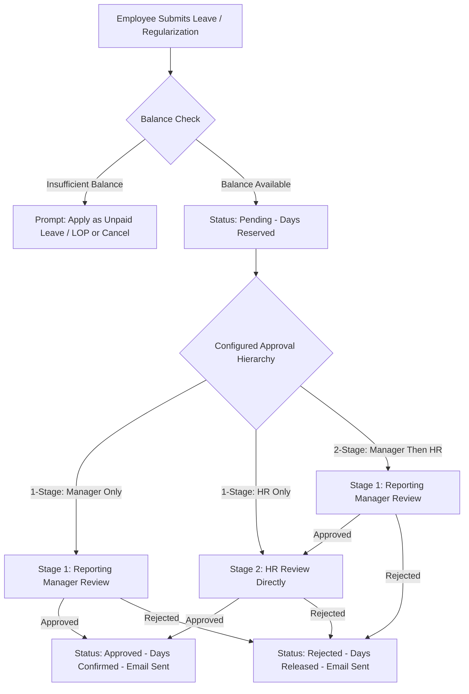
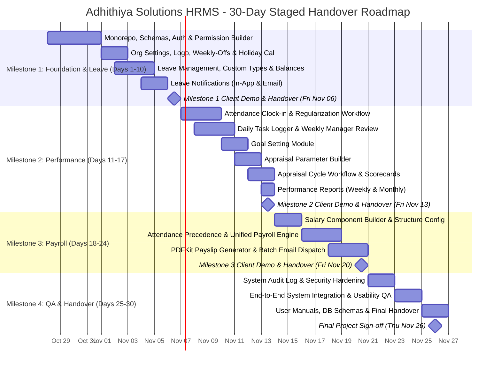

# Software Requirements Specification (SRS)
## Human Resource Management System (HRMS)

**Document Version:** 1.0 (Staged Architecture, Audit Logging & Client Scope Alignment)  
**Project Name:** Adhithiya Solutions HRMS  
**Client / Organization:** Adhithiya Solutions  
**Target Completion Timeline:** Exactly 30 Calendar Days (October 28, 2026 – November 26, 2026)  
**Document Status:** Working Baseline for Development & Client Acceptance  
**Prepared For:** Adhithiya Solutions Stakeholders & Engineering Team  

---

### Change Log (v1.3.0 -> v1.4.0)
- **Organization Settings Added (`FR-ORG`):** Added Organization Settings (`FR-ORG-001`, `FR-ORG-002`, `FR-ORG-003`) covering company details, logo for payslips, weekly-offs, and financial/leave year start; linked to leave calculations and payroll.
- **Attendance Precedence & Absence Definition:** Added `FR-ATT-005` (pre-fill from clock-in/out with mandatory audit reason for overrides), defined "absence" in `FR-ATT-004`, and made shift hour thresholds / late grace period configurable (with open question Q6).
- **Explicit Permission Flags:** Added `canManageLeavePolicy`, `canAdjustLeaveBalances`, `canConfigureSalary`, and `canConfigureAppraisalParams` to Section 2.2, replacing all generic "(if permitted)" entries in Section 2.4.
- **Schedule Realism:** Shifted Milestone 2 and 3 handovers to business days (Friday Nov 13 and Friday Nov 20); added Gantt bars for appraisals, reports, salary components, and attendance clock-in; moved leave notifications into Milestone 1; added risk note for tight schedule.
- **Client Facts vs. Proposals:** Retitled 10.1 to "Proposed Constraints (pending client confirmation)" and separated client text facts from engineering proposals in Section 11.
- **Audit Logging Added (`FR-AUDIT`):** Added `FR-AUDIT-001` and `FR-AUDIT-002` capturing actor, action, before/after values, reason, and timestamps for critical system events; added Super User read-only audit viewer and acceptance criterion.
- **Earned Leave Flexibility:** Added optional per-employee `earnedLeaveQuota` (default 12) alongside `isEligibleForEarnedLeave`; added open question Q7.
- **Minor Corrections:** Clarified PDF export for Holiday Calendar in Section 8 and `FR-REP-005`; expanded Q2 to cover mid-year pro-rating; added 3-click leave usability criterion to 9.4; removed exclamation marks in Section 1.5; updated Section 7 status note.

---

## 1. Project Overview

### 1.1 Purpose
This Software Requirements Specification (SRS) establishes the definitive functional, technical, non-functional, and operational requirements for developing a centralized, web-based Human Resource Management System (HRMS) for **Adhithiya Solutions**. This document defines the exact project scope, user roles, business rules, mathematical formulas, and technical specifications, serving as the benchmark for development sprints, test verification, and staged client acceptance.

### 1.2 Objectives
1. **Automate Core HR Operations:** Transition manual administrative and spreadsheet records into an integrated system covering the client's three core functional modules:
   - **Leave Management:** Applications, approval workflows, balance tracking, holiday calendar, and utilization reports.
   - **Performance Management:** Daily productivity tracking, weekly/monthly performance reports, goal setting, periodic appraisals, and feedback/ratings.
   - **Payroll Management:** Salary structure configuration, earnings/deductions, attendance- and leave-linked salary computation, and automated PDF payslip generation.
2. **Deliver Dual Dedicated Portals:**
   - **Employee Self-Service Portal (`apps/employee-portal`):** Dedicated to employees for profile access, leave applications, daily task logging, goal tracking, self-appraisals, and payslip downloads.
   - **Admin & Manager Portal (`apps/admin-portal`):** Dedicated to the Super User (system governance, sub-user permission builder, approval hierarchy configuration) and Sub-Users (HR/Department Managers with delegated, departmentally-scoped rights).
3. **Zero Recurring Infrastructure Licensing:** Built on a modern, self-contained MERN stack using local server storage (`/uploads`), embedded background job workers, and vector PDF rendering at ₹0 third-party software licensing overhead.
4. **Staged Delivery Model:** Prioritize and deliver the **Leave Management Module first** for early client review and operational deployment, followed sequentially by Performance Management and Payroll Management within the strict 30-calendar-day window.

### 1.3 Scope Management
The project scope is structured around the **three core functional modules** and the **cross-cutting access control and organizational foundation** specified by Adhithiya Solutions:

```
┌────────────────────────────────────────────────────────────────────────┐
│                   30-DAY PRIMARY DELIVERY SCOPE                        │
├────────────────────────────────────────────────────────────────────────┤
│ 1. ACCESS CONTROL & FOUNDATION (CROSS-CUTTING):                        │
│    • 3-Tier Access Control: Super User, Sub-Users, Employees           │
│    • Super User Permission Builder for Sub-Users (modular toggles)     │
│    • Configurable Approval Hierarchy (1-Stage vs. 2-Stage Chains)      │
│    • Organization Settings (Company profile, logo, weekly-offs, year)  │
│    • Employee Directory with 'isEligibleForEarnedLeave' & quota fields │
│    • System Audit Log (immutable event tracking and viewer)            │
│                                                                        │
│ 2. MODULE 1: LEAVE MANAGEMENT (DELIVERED FIRST):                       │
│    • Default 12 Sick Leave (SL) & 12 Casual Leave (CL) for all staff   │
│    • 12 Earned Leave (EL) for employees flagged as eligible            │
│    • Dynamic Leave Type Builder (add/edit custom types, paid/unpaid)   │
│    • Leave balance adjustments with mandatory audit reason             │
│    • Unified reservation lifecycle (reserved -> confirmed / released)  │
│    • Organization Holiday Calendar & Leave Utilization Reports         │
│    • In-App and Email Notifications for Leave actions                  │
│                                                                        │
│ 3. MODULE 2: PERFORMANCE MANAGEMENT:                                   │
│    • Daily Productivity Tracking (Task/timesheet logger, hours, notes) │
│    • Manager Weekly Review & Coaching Ratings (1–5 scale)              │
│    • Goal Setting (goals per cycle, progress %, manager comments)      │
│    • Appraisal Parameter Builder (competencies, scales, weights)       │
│    • Periodic Appraisals (Self-review, Manager evaluation, Sign-off)   │
│    • Weekly & Monthly Performance Reports (Excel / CSV exports)        │
│                                                                        │
│ 4. MODULE 3: PAYROLL MANAGEMENT & ATTENDANCE:                          │
│    • Monthly Attendance Input & Regularization Request Workflow        │
│    • Attendance Source Precedence (clock-in pre-fill, audit override)  │
│    • Attendance- and Leave-linked Salary Computation (unified LOP)     │
│    • Configurable Salary Component Builder (Earnings & Deductions)     │
│    • 1-Click Automated Vector PDF Payslip Generation (PDFKit)          │
│    • Monthly Payroll Reconciliation Sheets (Excel / CSV)               │
└────────────────────────────────────────────────────────────────────────┘
```

### 1.4 Stakeholders
| Stakeholder Group | Role & Primary Interest |
| :--- | :--- |
| **Executive Management (Client)** | Project sponsor; oversight on delivery timeline (30 days), compliance, and operational efficiency. |
| **Super User (System Admin)** | Complete administrative authority; organization configuration, user provisioning via permission builder, hierarchy setup, audit inspection, and report generation. |
| **Sub-Users (HR Managers & Dept Heads)** | Operational users; leave approvals, attendance verification, timesheet reviews, performance appraisal scoring, and payroll processing within assigned scopes. |
| **Employees (End Users)** | Self-service consumers; logging daily tasks, tracking goals, applying for leaves, submitting appraisals, and downloading payslips. |
| **Development Team** | Engineering, QA, and documentation specialists responsible for delivering the codebase, schemas, and manual within 30 days. |

### 1.5 Staged Handover Strategy (Exact 30-Day Calendar Alignment)
To maximize client visibility and guarantee delivery within exactly 30 calendar days (October 28 – November 26, 2026), handovers are scheduled on working business days:
- **Milestone 1 (Days 1–10: Oct 28 – Nov 06):** Core Foundation, Organization Settings, Auth, Employee Profiles, Leave In-App/Email Notifications, and **Complete Leave Management Module** $\rightarrow$ Handed over and demoed to client on Friday, November 06, 2026.
- **Milestone 2 (Days 11–17: Nov 07 – Nov 13):** Daily Productivity Tracking, Goal Setting, Appraisal Parameter Builder, and Performance Management $\rightarrow$ Handed over and demoed to client on Friday, November 13, 2026.
- **Milestone 3 (Days 18–24: Nov 14 – Nov 20):** Attendance Input Precedence, Salary Component Builder, Unified Payroll Calculation, and PDFKit Payslips $\rightarrow$ Handed over and demoed to client on Friday, November 20, 2026.
- **Milestone 4 (Days 25–30: Nov 21 – Nov 26):** End-to-End System Integration, Audit Logging, Security Hardening, End-User Manuals, and Final Client Sign-off on Thursday, November 26, 2026.

---

## 2. User Roles, Permissions & Dynamic Hierarchy

The system enforces a 3-tier Role-Based Access Control (RBAC) model. Access to API endpoints, database queries, and frontend views is strictly restricted according to the user's role and departmental scope.

### 2.1 Role Definitions
1. **Super User (System Administrator):**
   - Full administrative control across all modules, configuration settings, and database collections.
   - Configures company-wide master policies, organization settings (branding, weekly-offs), salary structures, appraisal parameters, holiday schedules, and approval hierarchies.
   - Creates and manages Sub-Users using the **Sub-User Permission Builder**.
   - Can override any pending approval, manually adjust balances with reasons, and inspect the read-only system audit log.
2. **Sub-Users (HR / Department Managers):**
   - Possess scoped administrative rights as assigned by the Super User.
   - Can be customized with modular permission toggles (e.g., approving leaves, reviewing productivity, processing payroll) restricted to specific department scopes.
3. **Users (Employees):**
   - Access restricted exclusively to their own profile, leave requests, productivity tasks, performance records, and payslips.

### 2.2 Super User Permission Builder for Sub-Users
The Super User creates and configures Sub-User accounts by assigning specific, modular permission flags and scope definitions:

| Permission Flag | Description / Scope of Authority |
| :--- | :--- |
| `canManageEmployees` | Authority to create, update, and deactivate employee profiles within assigned department(s). |
| `canApproveLeaves` | Authority to act as an approver in the leave approval workflow (Stage 1 Manager or Stage 2 HR). |
| `canManageLeavePolicy` | Authority to configure leave types, rules, quotas, and the organization holiday calendar. |
| `canAdjustLeaveBalances` | Authority to manually credit or debit an employee's leave balance with a mandatory audit reason. |
| `canManageAttendance` | Authority to record monthly attendance inputs and approve attendance regularization requests. |
| `canReviewProductivity` | Authority to view submitted daily timesheets, record weekly ratings, and provide feedback. |
| `canManageGoals` | Authority to assign goals to team members and review goal progress updates. |
| `canConfigureAppraisalParams` | Authority to configure custom appraisal competencies, parameters, rating scales, and weights. |
| `canManageAppraisals` | Authority to launch appraisal cycles, submit manager reviews, and evaluate team scorecards. |
| `canConfigureSalary` | Authority to configure salary components (earnings/deductions) and salary structure templates. |
| `canProcessPayroll` | Authority to review monthly attendance inputs, calculate payroll, and generate payslips. |
| `canExportReports` | Authority to export leave, productivity, performance, and payroll reports to Excel and CSV. |
| `departmentScope` | Array of department IDs (e.g., `["Engineering", "Sales"]`) or `["ALL"]` for organization-wide access. |

### 2.3 Configurable Approval Hierarchy
The Super User can configure the organizational approval hierarchy:
1. **Leave & Attendance Approval Hierarchy Modes:**
   - **Mode 1: 1-Stage Approval (Direct Manager Only):** The employee's assigned Reporting Manager approves or rejects the request directly.
   - **Mode 2: 1-Stage Approval (HR Only):** All requests bypass line managers and route directly to HR Sub-Users for approval.
   - **Mode 3: 2-Stage Approval (Manager $\rightarrow$ HR):** Stage 1 requires Department Reporting Manager approval. Upon Stage 1 approval, the request advances to Stage 2 for final HR sign-off.
   - *Fallback Rule:* If an employee has no assigned Reporting Manager, the request routes directly to HR / Super User.
2. **Performance Appraisal Hierarchy:** Follows a standard 3-tier calibration chain: Employee Self-Appraisal $\rightarrow$ Department Manager Evaluation $\rightarrow$ Super User Review & Final Sign-off.

### 2.4 Default Role Permissions Matrix (Recommended Baseline Presets)
*Note: The matrix below illustrates the recommended default presets. The Super User can customize any Sub-User's permissions using the Permission Builder via the explicit flags specified below.*

| Feature / Action | Super User | Default Preset: Sub-User (HR) | Default Preset: Sub-User (Dept Manager) | Employee |
| :--- | :---: | :---: | :---: | :---: |
| **Organization Settings (`FR-ORG`)** | Full Access | No Access | No Access | No Access |
| **Sub-User Permission Builder** | Full Access | No Access | No Access | No Access |
| **Configure Approval Hierarchies** | Full Access | No Access | No Access | No Access |
| **Manage Employee Profiles & Flags** | Full Access | Full Access *(if `canManageEmployees`)* | View Assigned Dept | View Own Profile |
| **Toggle `isEligibleForEarnedLeave` & Quota** | Full Access | Full Access *(if `canManageEmployees`)* | No Access | No Access |
| **Configure Leave Policies & Custom Types** | Full Access | View / Edit *(if `canManageLeavePolicy`)* | View Only | View Holiday Calendar |
| **Apply for Leave** | Yes *(Self)* | Yes *(Self)* | Yes *(Self)* | Yes *(Self)* |
| **Approve / Reject Leave Requests** | Full (Global) | Stage 2 / Full *(if `canApproveLeaves`)* | Stage 1 (Dept) *(if `canApproveLeaves`)* | No Access |
| **Adjust Employee Leave Balances** | Full Access | Full Access *(if `canAdjustLeaveBalances`)* | No Access | No Access |
| **Record Monthly Attendance Inputs** | Full Access | Full Access *(if `canManageAttendance`)* | View / Input (Dept) *(if `canManageAttendance`)* | No Access |
| **Approve Attendance Regularization** | Full Access | Stage 2 / Full *(if `canManageAttendance`)* | Stage 1 (Dept) *(if `canManageAttendance`)* | Submit Own Request |
| **Log Daily Tasks / Timesheets** | Optional | Optional | Optional | Submit Own Tasks |
| **Review & Rate Daily Timesheets** | Full Access | Full Access *(if `canReviewProductivity`)* | Dept Team Only *(if `canReviewProductivity`)* | No Access |
| **Assign & Review Goals** | Full Access | Full Access *(if `canManageGoals`)* | Dept Team Only *(if `canManageGoals`)* | Update Own Progress |
| **Configure Appraisal Parameters** | Full Access | View / Edit *(if `canConfigureAppraisalParams`)* | No Access | No Access |
| **Launch Appraisal Cycles** | Full Access | Full Access *(if `canManageAppraisals`)* | No Access | No Access |
| **Submit Self-Appraisal** | Yes *(Self)* | Yes *(Self)* | Yes *(Self)* | Submit Own Assessment |
| **Evaluate & Score Appraisals** | Full Access | Full Access *(if `canManageAppraisals`)* | Assigned Reportees *(if `canManageAppraisals`)* | View Published Result |
| **Configure Salary Components** | Full Access | View / Edit *(if `canConfigureSalary`)* | No Access | No Access |
| **Run Payroll & Compute LOP** | Full Access | Full Access *(if `canProcessPayroll`)* | No Access *(Configurable by Super User)* | No Access |
| **Generate & Publish Payslip PDFs** | Full Access | Full Access *(if `canProcessPayroll`)* | No Access *(Configurable by Super User)* | No Access |
| **Download Payslip PDF** | Any Employee | Assigned Scope | No Access | Download Own Only |
| **Export Reports (Excel / CSV)** | Full (Global) | Assigned Scope *(if `canExportReports`)* | Dept Scope Only *(if `canExportReports`)* | No Access |
| **System Audit Log Viewer (`FR-AUDIT`)** | Full Access (Read-Only) | No Access | No Access | No Access |

---

## 3. Functional Requirements

### 3.1 Organization Settings (`FR-ORG`)
- **`FR-ORG-001`**: The system shall provide an Organization Configuration module restricted to Super Users to configure company profile information: Company Name, Official Address, Contact Email, Phone, Tax/Registration IDs, and Company Logo image (stored in `/uploads/branding` and stamped onto generated payslip PDFs).
- **`FR-ORG-002`**: The Super User shall configure organizational operational schedules:
  - Weekly-off days (e.g., Saturday and Sunday, or Sunday only, or alternating Saturdays).
  - Financial Year and Leave Year start and end dates (e.g., January 01 – December 31, or April 01 – March 31).
- **`FR-ORG-003`**: The system's leave duration calculation engine (`FR-LEAVE-004`) and payroll standard working day computation (Section 5.2) shall dynamically read designated weekly-off days and calendar year boundaries from these organization settings.

### 3.2 Authentication & Authorization (`FR-AUTH`)
- **`FR-AUTH-001`**: Secure email-and-password authentication for Super Users, Sub-Users, and Employees.
- **`FR-AUTH-002`**: Transmission of JWT Access Tokens (15-minute expiry) and Refresh Tokens (7-day expiry) inside secure, `HttpOnly`, `SameSite=Strict` cookies.
- **`FR-AUTH-003`**: Password complexity validation (minimum 8 characters, uppercase, number, special character) hashed with `bcryptjs` (cost factor 12).
- **`FR-AUTH-004`**: Password reset workflow via time-limited (15 minutes) email tokens.
- **`FR-AUTH-005`**: Sub-User Permission Builder API allowing Super Users to dynamically grant/revoke permission flags (`canManageEmployees`, `canApproveLeaves`, `canManageLeavePolicy`, `canAdjustLeaveBalances`, `canManageAttendance`, `canReviewProductivity`, `canManageGoals`, `canConfigureAppraisalParams`, `canManageAppraisals`, `canConfigureSalary`, `canProcessPayroll`, `canExportReports`) and department scopes.
- **`FR-AUTH-006`**: Strict route authorization middleware returning HTTP 403 Forbidden whenever an Employee or unauthorized Sub-User attempts to access restricted Admin routes.

### 3.3 Employee Information Management (`FR-EMP`)
- **`FR-EMP-001`**: Profile management for creating, editing, and deactivating employee records.
- **`FR-EMP-002`**: Employee profile data fields:
  - Personal Details: Full Name, Employee Code (unique), DOB, Gender, Personal Email, Phone Number, Residential Address.
  - Employment Details: Official Email, Joining Date, Department, Designation, Reporting Manager ID, Employment Type, Status (*Active, Probation, Resigned, Terminated*).
  - **Earned Leave Configuration:** Explicit boolean flag `isEligibleForEarnedLeave` (default: `false`) and optional numeric field `earnedLeaveQuota` (default: 12 days).
  - Financial Details: Bank Name, Account Number, IFSC Code, PAN Number, PF UAN *(optional)*, ESI Number *(optional)*.
- **`FR-EMP-003`**: Self-service profile viewing and profile picture upload (stored in `/uploads/avatars` with file-type and 5MB size validation).
- **`FR-EMP-004`**: Searchable Employee Directory with multi-criteria filters (department, designation, status).

### 3.4 Leave Management Module (`FR-LEAVE`) - *Delivered First*
- **`FR-LEAVE-001`**: Provisioning of standard annual leave balances:
  - **Sick Leave (SL):** 12 days / year automatically allocated to **all employees**.
  - **Casual Leave (CL):** 12 days / year automatically allocated to **all employees**.
  - **Earned Leave (EL):** Allocated only to employees where `isEligibleForEarnedLeave === true`, granting their assigned `earnedLeaveQuota` (default: 12 days / year). If the flag is `false`, EL balance remains 0.
- **`FR-LEAVE-002`**: **Dynamic Leave Type Builder:** Super User can create, edit, or deactivate custom Leave Types (e.g., Maternity Leave, Paternity Leave, Bereavement Leave, Comp-off) in addition to standard SL/CL/EL, configuring whether each is paid or unpaid, annual quota, and carry-forward limits.
- **`FR-LEAVE-003`**: Leave application form supporting Leave Type (SL, CL, EL, custom types, or Unpaid/LOP), Start Date, End Date, Half-Day toggle (First/Second Half), and Reason.
- **`FR-LEAVE-004`**: Automated duration calculation reading designated weekly-offs from Organization Settings (`FR-ORG-002`, `FR-ORG-003`) and paid public holidays from the Holiday Calendar.
- **`FR-LEAVE-005`**: **Unified Balance Lifecycle (Reservation Model):**
  - *At Submission:* Requested leave days are immediately **Reserved / Held** from the available balance:
    $$\text{Available Balance} = \text{Total Quota} - \text{Confirmed Days} - \text{Pending Reserved Days}$$
  - *On Final Approval:* Reserved days transition to **Confirmed / Deducted**.
  - *On Rejection or Pre-start Cancellation:* Reserved days are immediately **Released / Restored** back to the Available Balance.
- **`FR-LEAVE-006`**: Real-time balance validation preventing applications exceeding Available Balance (unless applied as Unpaid Leave / LOP).
- **`FR-LEAVE-007`**: Enforcement of the **Configurable Approval Hierarchy** (1-Stage or 2-Stage per organization settings).
- **`FR-LEAVE-008`**: **Manual Balance Adjustment:** Super User and authorized HR Sub-Users (holding `canAdjustLeaveBalances`) can manually credit or debit an employee's leave balance, requiring a mandatory recorded audit reason logged to `FR-AUDIT-001`.
- **`FR-LEAVE-009`**: Centralized Holiday Calendar management where Super Users create and publish annual paid holidays.
- **`FR-LEAVE-010`**: Exportable Leave Reports (leave utilization by department, individual balances, pending leaves) to Excel (`.xlsx`) and CSV (`.csv`).
- **`FR-LEAVE-011`**: In-app notification alerts and transactional SMTP emails for leave submissions, approvals, rejections, and cancellations delivered as part of Milestone 1.

### 3.5 Attendance Management (`FR-ATT`)
- **`FR-ATT-001`**: **Monthly Attendance Input Sheet:** Super User or HR Sub-User can view and record monthly attendance figures per employee (Total Working Days, Days Present, Paid Leaves, and Unpaid/Absent LOP Days) before triggering payroll.
- **`FR-ATT-002`**: **Daily Web Clock-In / Clock-Out:** Employees can record daily web clock-in and clock-out timestamps from the Employee Portal. Minimum hours required for Full-Day credit (default: 8 hours) vs. Half-Day credit (default: 4 hours) and late-arrival grace period (default: 15 minutes past shift start) are configurable parameters in system settings (see Open Question Q6).
- **`FR-ATT-003`**: **Attendance Regularization Workflow:** Employees can submit regularization requests for missed punches, routing through the configured approval hierarchy (Stage 1 Manager $\rightarrow$ Stage 2 HR).
- **`FR-ATT-004`**: **Absence Definition & Attendance Aggregation for Payroll:** The system defines an "absence" as any scheduled business working day on which an employee has no clock-in punch, no approved leave, and which is not a designated paid holiday or configured weekly-off day (`FR-ORG-002`). The system aggregates confirmed LOP days from approved unpaid leaves and unregularized absences to directly feed the payroll calculation engine.
- **`FR-ATT-005`**: **Attendance Source Precedence:** Clock-in/out records and approved leave records pre-fill the monthly attendance input sheet automatically. Authorized HR Sub-Users or Super Users review and confirm the sheet; any manual override to present days, leave days, or LOP days requires a mandatory recorded audit reason and is logged in the Audit Log (`FR-AUDIT-001`).

### 3.6 Daily Productivity Tracking (`FR-PROD`)
- **`FR-PROD-001`**: **Daily Task Logger:** In the Employee Portal, employees submit daily timesheets recording:
  - Work Date.
  - Project / Category Name.
  - Task Title and Summary Description.
  - Hours Spent (numerical with decimal support, e.g., 2.5 hours).
  - Status (*In Progress, Completed, Blocked*).
  - Self-Reported Productivity Notes (challenges, achievements).
- **`FR-PROD-002`**: Timesheet entry validation: Ensures logged daily hours are greater than 0 and do not exceed 16 hours/day. Allows same-day edits until 23:59:59 local time.
- **`FR-PROD-003`**: **Manager Review Console:** Department Managers view daily timesheet submissions for their assigned team members.
- **`FR-PROD-004`**: **Weekly Manager Rating & Feedback:** Managers can submit a weekly rating (1 to 5 scale) along with coaching feedback comments for each team member's logged week.

### 3.7 Goal Setting & Performance Management (`FR-PERF`)
- **`FR-PERF-001`**: **Goal Setting:** 
  - Managers or Employees can create specific goals for an active cycle (Goal Title, Target Completion Date, Description, Priority/Weight).
  - Employees update self-reported goal progress percentage ($0\%$ to $100\%$) and completion notes.
  - Managers can view progress and add ongoing review comments.
- **`FR-PERF-002`**: **Appraisal Parameter Builder:** Super User (or HR Sub-Users holding `canConfigureAppraisalParams`) can configure custom organizational appraisal parameters and evaluation criteria (e.g., Technical Competency, Communication, Leadership), assigning descriptions, rating scales (1–5), and weighting percentages summing to 100%.
- **`FR-PERF-003`**: **Appraisal Cycle Orchestration:** Super User or HR launches periodic Appraisal Cycles (Quarterly or Annual) with defined submission deadlines.
- **`FR-PERF-004`**: **Self-Appraisal Form:** Employees complete a structured self-evaluation rating their performance against configured appraisal parameters with qualitative notes.
- **`FR-PERF-005`**: **Manager Review & Scoring:** Reporting Managers review the employee's self-appraisal, goal completion rates, and daily productivity history, assigning manager scores and narrative evaluation comments.
- **`FR-PERF-006`**: **Super User Sign-off & Publication:** Super Users review scores, calibrate if necessary, and execute final sign-off, making the scorecard visible to the employee.
- **`FR-PERF-007`**: **Performance Reports:** System generates Weekly and Monthly Performance Reports aggregating timesheet hours, goal progress status, and appraisal ratings.

### 3.8 Payroll Management (`FR-PAY`)
- **`FR-PAY-001`**: Salary Component Builder for defining custom Earnings (Basic, HRA, Allowances, Bonuses) and Deductions (Statutory PF/ESI/PT/Tax slabs, LOP).
- **`FR-PAY-002`**: Salary Structure Assignment linking an individualized monthly gross base and component breakdown to each employee profile.
- **`FR-PAY-003`**: **Unified Attendance- and Leave-Linked Salary Computation:** Automatically computes monthly payable days, deducting unpaid/LOP days while treating approved paid leaves ($L_{paid}$) and public holidays ($H_{pub}$) as fully paid (Section 5.2).
- **`FR-PAY-004`**: Pre-Payroll Review Grid in Admin Portal allowing HR to review draft computations, make manual adjustments, and freeze the payroll batch. All adjustments require an audit reason logged to `FR-AUDIT-001`.
- **`FR-PAY-005`**: **1-Click Vector PDF Payslip Generation:** Uses pure Node.js `PDFKit` to generate professional, branded payslip PDFs stamped with company logo (`FR-ORG-001`), company details, employee details, working days, itemized earnings, and itemized deductions.
- **`FR-PAY-006`**: Secure local storage of payslip PDFs in `/uploads/payslips/<year>/<month>/` accessible only via authenticated streaming routes. Direct unauthenticated downloads are strictly blocked.
- **`FR-PAY-007`**: Automated batch email dispatch of payslip PDFs to employee inboxes via SMTP.

### 3.9 Reporting & Data Export (`FR-REP`)
- **`FR-REP-001`**: Leave Reports (leave utilization by department, individual balances, rejection history).
- **`FR-REP-002`**: Weekly & Monthly Performance Reports (timesheet hours logged, task completion rates, manager weekly ratings, goal completion status).
- **`FR-REP-003`**: Appraisal Summary Reports (department score averages, completed reviews).
- **`FR-REP-004`**: Monthly Payroll Summary & Bank Disbursement Sheets (gross pay, itemized deductions, LOP days, net payout).
- **`FR-REP-005`**: Formatted Excel (`.xlsx`) and CSV (`.csv`) export for all tabular reports, and PDF export for the Annual Holiday Calendar Schedule and individual payslips.

### 3.10 Notification Engine (`FR-NOTIF`)
- **`FR-NOTIF-001`**: In-app real-time notification drawer/badge in both portals for leave status updates, goal reviews, appraisal launches, and payslip releases.
- **`FR-NOTIF-002`**: Transactional email notifications via `nodemailer` (SMTP) for leave submissions, approvals, rejections, and payslips.

### 3.11 System Audit Log (`FR-AUDIT`)
- **`FR-AUDIT-001`**: The system shall automatically record immutable audit log entries capturing: Actor ID, Actor Role, Action Type, Target Entity, Before-Value, After-Value, User-Provided Reason (where applicable), IP Address, and Server Timestamp for the following critical operations:
  - Leave balance manual adjustments (`FR-LEAVE-008`).
  - Leave approvals, rejections, and cancellations (`FR-LEAVE-005`).
  - Sub-User Permission Builder modifications (`FR-AUTH-005`).
  - Approval hierarchy policy configuration changes (`FR-LEAVE-007`).
  - Employee `isEligibleForEarnedLeave` flag and `earnedLeaveQuota` modifications (`FR-EMP-002`).
  - Attendance manual overrides on the monthly sheet (`FR-ATT-005`).
  - Payroll pre-run manual adjustments and payroll batch freeze (`FR-PAY-004`).
  - Appraisal score calibrations and final sign-off (`FR-PERF-006`).
- **`FR-AUDIT-002`**: Super Users shall have access to an Audit Log Viewer in the Admin Portal providing read-only inspection, search, and filtering by date range, actor, action, and entity type. Audit records cannot be modified or deleted through the application interface.

---

## 4. Leave Policies & Rules

The following policies reflect the client’s stated baseline requirements with clear per-employee eligibility rules:

### 4.1 Leave Entitlements Summary
| Leave Category | Annual Allowance | Applicable Employees | Allocation Mechanism |
| :--- | :---: | :--- | :--- |
| **Sick Leave (SL)** | **12 Days** | **All Employees** by default. | Allocated annually (or pro-rated upon joining). |
| **Casual Leave (CL)** | **12 Days** | **All Employees** by default. | Allocated annually (or pro-rated upon joining). |
| **Earned Leave (EL)** | **Configurable (Default 12 Days)** | **Eligible Employees Only** (controlled by `isEligibleForEarnedLeave`). | Allocated when `isEligibleForEarnedLeave === true`, granting `earnedLeaveQuota` (default 12). Default is 0. |
| **Custom Leave Types** | Configurable | Configurable per policy. | Added dynamically via Leave Type Builder. |

### 4.2 Leave Operational Rules
1. **Earned Leave Eligibility Flag & Quota:**
   - Every employee profile has an explicit boolean setting: `isEligibleForEarnedLeave` (default: `false`) and an optional numeric quota `earnedLeaveQuota` (default: 12 days).
   - HR / Super User toggles this flag to `true` when an employee meets company eligibility criteria (e.g., completion of probation or 12 months continuous service).
   - Upon setting the flag to `true`, the system provisions the employee's assigned `earnedLeaveQuota` (pro-rated if enabled mid-year). If `false`, EL quota remains 0 and cannot be applied for.
2. **Accrual & Pro-rating [TBD - Pending Client Confirmation]:**
   - For mid-year joiners:
     $$\text{Pro-rated Quota} = \left\lceil \frac{\text{Remaining Full Months in Year}}{12} \times \text{Annual Quota} \right\rceil$$
   - Accrual schedule: **[TBD]** Default: Upfront annual allocation on Jan 1 vs. Monthly accrual (1 day/month). See Open Question Q2.
3. **Carry-Forward and Encashment [TBD - Pending Client Confirmation]:**
   - Casual Leave (CL) & Sick Leave (SL): **[TBD]** Default assumption: Lapses at calendar year-end (December 31); no carry-forward or encashment.
   - Earned Leave (EL): **[TBD]** Default assumption: Up to 15 days can be carried forward to the following year; encashable upon exit.
4. **Consecutive Days & Medical Documentation [TBD]:**
   - **[TBD]** Client to confirm if medical certificate upload is required when Sick Leave exceeds 2 or 3 consecutive days.
5. **Unified Balance Lifecycle Rule:**
   - **Submission:** Days are immediately **Reserved** from the available balance.
   - **Approval:** Reserved days become **Confirmed**.
   - **Rejection / Pre-start Cancellation:** Reserved days are immediately **Released** back to the available quota.

---

## 5. Business Rules and Unified Payroll Calculation

### 5.1 Configurable Approval Workflow


### 5.2 Unified Payroll Calculation Method
To eliminate mathematical ambiguity, the HRMS implements **ONE standard calculation model**.

#### Step 1: Day Categorization in Month $M$
- $T_{cal}$: Total Calendar Days in Month (e.g., 28, 29, 30, or 31).
- $W_{std}$: Standard Working Days in Month ($T_{cal}$ minus weekly-offs configured in Organization Settings (`FR-ORG-002`, `FR-ORG-003`) and official paid public holidays).
- $D_{pres}$: Days worked / present by the employee.
- $L_{paid}$: Approved Paid Leaves (SL, CL, EL, or paid custom leaves taken within available balance).
- $H_{pub}$: Paid Public Holidays occurring within the month.
- $D_{unpaid}$: Unpaid / Loss of Pay (LOP) Days (unapproved absences + leaves taken beyond available balance).

#### Step 2: Treatment of Paid Leaves and Holidays
- **Approved Paid Leaves ($L_{paid}$) and Paid Public Holidays ($H_{pub}$) are fully payable days.** They do **NOT** incur any deduction.
- **Only Unpaid Days ($D_{unpaid}$)** incur Loss of Pay (LOP) deductions.

#### Step 3: Per-Day Salary Rate (Divisor Policy)
$$\text{Per Day Salary Rate} = \frac{\text{Monthly Gross Base}}{\text{Divisor Days}}$$

*Divisor Options [TBD - Client Confirmation Required]:*
- **Option A (Actual Calendar Days - Standard Corporate Practice):** $\text{Divisor Days} = T_{cal}$ (e.g., 30 or 31 days).
- **Option B (Fixed 26-Day Divisor - Standard Industrial Practice):** $\text{Divisor Days} = 26$ days.
- **Option C (Net Working Days):** $\text{Divisor Days} = W_{std}$ (calendar days minus weekly offs and holidays).

*System Configuration:* Super User can select Option A, Option B, or Option C in Admin Settings. **Default baseline: Option A (Actual Calendar Days).**

#### Step 4: Final Salary Computation Formulas
1. **Loss of Pay (LOP) Deduction:**
   $$\text{LOP Deduction} = \text{Per Day Salary Rate} \times D_{unpaid}$$
2. **Earned Gross Salary:**
   $$\text{Earned Gross} = \text{Monthly Gross Base} - \text{LOP Deduction}$$
3. **Statutory Deductions [TBD - Rates Pending Client Confirmation]:**
   - Employee PF, ESI, Professional Tax (PT), and TDS/Tax deductions configured via Salary Component Builder.
   $$\text{Total Deductions} = \text{LOP Deduction} + \text{PF} + \text{ESI} + \text{PT} + \text{TDS} + \text{Other Deductions}$$
4. **Net Take-Home Salary:**
   $$\text{Net Salary} = \text{Earned Gross} - (\text{PF} + \text{ESI} + \text{PT} + \text{TDS} + \text{Other Deductions}) + \text{Reimbursements / Bonuses}$$

---

## 6. Non-Functional Requirements

### 6.1 Security & Data Protection (`NFR-SEC`)
- **`NFR-SEC-001`**: All API traffic carrying authentication tokens or employee data must be encrypted using HTTPS (TLS 1.3).
- **`NFR-SEC-002`**: User passwords must be hashed using `bcryptjs` (salt rounds: 12). Plaintext passwords must never be stored.
- **`NFR-SEC-003`**: Strict API authorization checks preventing Insecure Direct Object References (IDOR); users can only access their own records unless holding Super User or assigned Sub-User permissions. Unauthorized access attempts must return HTTP 403 Forbidden.
- **`NFR-SEC-004`**: Security middleware (`helmet`) enforcing standard secure HTTP headers (HSTS, CSP, X-Frame-Options).
- **`NFR-SEC-005`**: Rate-limiting restricting login attempts to maximum 10 requests per 15 minutes per IP, returning HTTP 429 Too Many Requests upon threshold violation.

### 6.2 Privacy & Sensitive Data (`NFR-PRIV`)
- **`NFR-PRIV-001`**: Financial and statutory details (bank accounts, PAN, salary amounts) must be accessible exclusively to the employee, authorized HR Sub-Users, and Super Users.
- **`NFR-PRIV-002`**: Uploaded files and generated payslips in `/uploads/` shall be accessible exclusively via authenticated Express streaming routes that verify JWT cookie authorization. Direct unauthenticated HTTP requests must return HTTP 401 Unauthorized. Direct web server directory browsing must be disabled.

### 6.3 Validation & Performance (`NFR-PERF`)
- **`NFR-PERF-001`**: Inbound API requests validated using `Zod` schemas. Malformed inputs return HTTP 400 with actionable field-level errors.
- **`NFR-PERF-002`**: Responsive user interface across desktop (minimum 1280px), tablet (768px–1024px), and mobile viewports (minimum 375px).
- **`NFR-PERF-003`**: Standard REST API read operations complete in under 300 ms for up to 100 concurrent users.
- **`NFR-PERF-004`**: Single payslip PDF generation via `PDFKit` completes in under 500 ms; batch generation for 100 employees completes in under 45 seconds asynchronously.

---

## 7. Technical Requirements & Stack Specification

The HRMS is architected on a modern, robust **MERN Monorepo Stack**. Software versions are recommended; confirm against the official release schedule before kickoff:

| Layer | Technology | Recommended Version | Support Status & Architecture Justification |
| :--- | :--- | :---: | :--- |
| **Backend Runtime** | **Node.js** | **`v24.x LTS`** / **`v26.x LTS`** | **Active / Maintenance LTS:** Node 24 is Maintenance LTS (supported through 2028); Node 26 is Active LTS. *(Node 22 reaches EOL in April 2027; Node 20 is EOL).* |
| **Backend Framework** | **Express.js** | `^4.21.x` / `5.x` | Minimalist, stable REST API routing and middleware chaining. |
| **Backend Language** | **TypeScript** | `^5.7.x` | Strict typing across controllers, models, and shared contracts. |
| **Database & ODM** | **MongoDB** + **Mongoose** | MongoDB 7/8 / Mongoose `^8.10.x` | Strongly typed document datastore with Mongoose validation hooks. |
| **Validation** | **Zod** | `^3.24.x` | Universal schema validation with automatic TypeScript type inference. |
| **Authentication** | `jsonwebtoken` + `bcryptjs` | `^9.0.x` / `^2.4.x` | Signed JWT tokens in HttpOnly cookies with salted password hashing. |
| **PDF Generation Engine** | **PDFKit** | `^0.15.x` | Pure Node.js vector PDF rendering; zero Chromium/browser dependencies, minimal RAM usage. |
| **Spreadsheet Engine** | **ExcelJS** | `^4.4.x` | High-performance generation of formatted `.xlsx` spreadsheets and `.csv`. |
| **Job Scheduling** | **node-cron** | `^3.0.x` | Embedded in-process cron runner for auto-absent marking and leave accruals (**₹0 hosting fee**). |
| **Email Service** | **Nodemailer** | `^6.10.x` | Transactional email delivery via standard SMTP (Gmail, Outlook, or custom SMTP). |
| **File Storage** | **Local Server File System** | Node `fs` / `multer` | Stored in `/uploads` protected by Express authentication (**₹0 cloud storage fees**). |
| **Frontend Framework** | **React** | `^19.0.x` | Component architecture, Actions, React 19 compiler optimizations. |
| **Frontend Tooling** | **Vite** | **`^6.x` / `^7.x`** | High-speed HMR, lightweight dev server, requires modern Node.js runtime natively supporting ESM. |
| **Frontend Language** | **TypeScript** | `^5.7.x` | Compile-time safety and type contracts synchronized with backend API. |
| **Styling & Design System** | **Tailwind CSS** + **Radix UI** | `^3.4.x` / `^4.0` | Accessible component primitives (dialogs, dropdowns, tabs), custom enterprise dark/light theme. |
| **State & API Layer** | **Redux Toolkit (RTK Query)** | `^2.5.x` | Global state management, automated query caching, optimistic UI updates. |
| **Form Management** | **React Hook Form** + `@hookform/resolvers/zod` | `^7.54.x` | Fast, uncontrolled forms coupled with Zod client-side schema validation. |
| **Testing Suite** | **Vitest** + **Supertest** | Latest | Zero-cost testing framework for unit tests, business logic, and API route verification. |

---

## 8. Reports and Exports

The system provides operational reporting with instant preview and formatted export to Microsoft Excel (`.xlsx`), Comma-Separated Values (`.csv`), and Adobe PDF (`.pdf`).

| Report Name | Frequency | Target Audience | Fields Included | Supported Formats |
| :--- | :--- | :--- | :--- | :---: |
| **Leave Utilization Report** | On-Demand / Monthly | HR & Super User | Employee Code, Name, Department, Leave Category, Days Taken, Available Balance, Rejection Count. | Excel, CSV |
| **Holiday Calendar Schedule** | Annual | All Users | Holiday Name, Date, Day of Week, Type (*Mandatory, Optional*). | Web, PDF |
| **Weekly Performance Report** | Weekly | Managers & HR | Employee Code, Name, Tasks Completed, Total Hours Logged, Goal Milestones, Manager Weekly Rating. | Excel, CSV |
| **Monthly Performance Report** | Monthly | Managers & HR | Employee Code, Department, Monthly Hours, Average Weekly Rating, Active Goal Progress %, Coaching Notes. | Excel, CSV |
| **Performance Appraisal Summary** | Post-Cycle | Super User & HR | Employee Code, Name, Department, Self Score, Manager Score, Final Calibrated Rating, Review Status. | Excel, CSV |
| **Monthly Payroll Reconciliation Sheet**| Monthly / Pay Cycle | Super User & HR | Employee Code, Bank Account, Gross Salary, Basic, HRA, Allowances, Total Deductions, LOP Days, Net Pay. | Excel, CSV |
| **Individual Monthly Payslip** | Monthly | Employee & HR | Company Details, Logo, Employee Info, Month/Year, Working Days, Itemized Earnings, Itemized Deductions, Net Payout. | Vector PDF |

---

## 9. Acceptance Criteria

The system shall be formally accepted by Adhithiya Solutions upon satisfying the following verifiable conditions across milestone handovers:

### 9.1 Milestone 1: Authentication, Organization Settings, Access Control & Leave Management (Days 1–10: Oct 28 – Nov 06)
- [ ] Super User, Sub-Users, and Employees can log in with credentials; JWT tokens are securely stored in `HttpOnly` cookies.
- [ ] Attempting to access Admin Portal routes or restricted API endpoints (`/api/admin/*`) as an Employee returns **HTTP 403 Forbidden**.
- [ ] Super User can configure company name, address, logo, weekly-off days, and leave/financial year start via Organization Settings (`FR-ORG-001`, `FR-ORG-002`).
- [ ] Super User can access the **Sub-User Permission Builder** to create Sub-Users, toggle modular permissions (`canManageEmployees`, `canApproveLeaves`, `canManageLeavePolicy`, `canAdjustLeaveBalances`, `canManageAttendance`, `canReviewProductivity`, `canManageGoals`, `canConfigureAppraisalParams`, `canManageAppraisals`, `canConfigureSalary`, `canProcessPayroll`, `canExportReports`), and assign departmental scopes.
- [ ] Super User can configure the **Approval Hierarchy** (1-Stage vs. 2-Stage) in Admin Settings.
- [ ] Super User can dynamically create, edit, and deactivate custom Leave Types using the **Leave Type Builder**.
- [ ] All active employees are initialized with 12 Sick Leave and 12 Casual Leave days; employees with `isEligibleForEarnedLeave === true` receive their assigned `earnedLeaveQuota` (default 12), while employees with `isEligibleForEarnedLeave === false` have 0 EL.
- [ ] Employee can apply for leave; request days are immediately **reserved**; duration correctly excludes weekly-offs configured in `FR-ORG-002`; request routes through the configured approval chain (Manager and/or HR).
- [ ] Leave days transition to **confirmed** upon final approval, and are immediately **released** back to the available quota if rejected or cancelled prior to the start date.
- [ ] In-app notification badge alerts and transactional SMTP email delivery verify successfully for leave submissions, approvals, rejections, and cancellations (`FR-LEAVE-011`).
- [ ] Super User and HR (holding `canAdjustLeaveBalances`) can manually adjust employee leave balances with a mandatory audit reason logged to `FR-AUDIT-001`.
- [ ] Super User can manage the Holiday Calendar and export Leave Utilization Reports to Excel and CSV, and the Holiday Schedule to PDF.

### 9.2 Milestone 2: Daily Productivity, Goal Setting & Appraisals (Days 11–17: Nov 07 – Nov 13)
- [ ] Employee can log daily tasks with project name, task title, hours spent, status, and self-reported notes; same-day edits allowed until 23:59:59.
- [ ] Manager can view team timesheets and submit a weekly rating (1–5 scale) and feedback comments.
- [ ] Manager and Employee can create goals per cycle, and Employee can update progress percentage ($0-100\%$).
- [ ] Super User (or HR holding `canConfigureAppraisalParams`) can configure custom competencies, scales, and weights using the **Appraisal Parameter Builder**.
- [ ] Super User/HR can launch an appraisal cycle; Employee can submit self-appraisal; Manager can evaluate and score.
- [ ] Super User can review, calibrate, and sign off to publish the scorecard.
- [ ] System generates and exports Weekly and Monthly Performance Reports to Excel and CSV.

### 9.3 Milestone 3: Attendance, Payroll Engine & Payslip Generation (Days 18–24: Nov 14 – Nov 20)
- [ ] Clock-in/out records pre-fill the monthly attendance sheet; HR can review and record overrides with mandatory audit reasons (`FR-ATT-005`).
- [ ] Super User (or HR holding `canConfigureSalary`) can configure salary components and assign salary structures to employees.
- [ ] Monthly attendance inputs and LOP days automatically feed into the unified payroll calculation engine:
  $$\text{LOP Deduction} = \frac{\text{Monthly Gross Base}}{\text{Divisor Days}} \times D_{unpaid}$$
- [ ] Approved paid leaves and public holidays are verified as fully paid with zero deduction.
- [ ] 1-click batch generation produces downloadable, branded PDF payslips via `PDFKit` stamped with the company logo from `FR-ORG-001`.
- [ ] Direct unauthenticated HTTP requests to `/uploads/payslips/*` return **HTTP 401 Unauthorized**.
- [ ] Monthly Payroll Reconciliation Sheet exports cleanly to formatted Excel and CSV files.

### 9.4 Milestone 4: Integration, Audit Logging, Usability & Final Handover (Days 25–30: Nov 21 – Nov 26)
- [ ] Super User can access the read-only System Audit Log Viewer (`FR-AUDIT-001`, `FR-AUDIT-002`) to inspect recorded audit events (leave adjustments, permission changes, payroll freezes, and attendance overrides) with timestamp, actor, and before/after values.
- [ ] Usability validation: A newly onboarded employee can submit a leave application in 3 clicks or fewer from the Employee Portal dashboard without prior system training.
- [ ] Real-time in-app notification badge triggers on appraisal cycle launches and payslip releases.
- [ ] Transactional SMTP email delivery verified for payslip dispatch.
- [ ] Responsive UI verified on mobile (375px), tablet (768px), and desktop (1280px+).
- [ ] Brute-force rate limiting returns HTTP 429 after 10 failed login attempts within 15 minutes.
- [ ] Complete handover deliverables validated: Source code monorepo, environment configuration `.env.example`, database seed script (`npm run seed`), Database ERD documentation, Employee User Manual, and Admin User Manual.

---

## 10. Project Constraints, Priorities & Staged Handover Roadmap

### 10.1 Proposed Constraints (Pending Client Confirmation)
1. **Strict 30-Day Completion Target:** The entire solution must be coded, tested, documented, and packaged within exactly 30 calendar days (October 28 – November 26, 2026).
2. **Zero-Cost Third-Party Software Requirement:** All runtime components, libraries, file storage, PDF generators, and databases must use open-source or self-hosted solutions requiring ₹0 third-party API or cloud storage licenses.
3. **Single-Tenant Deployment:** Designed for one organization instance with rich internal administrative configuration tables.

### 10.2 Staged Handover Roadmap & Sprints (Exact 30 Calendar Days)



> **Schedule Risk Note:** Milestones 1 and 3 are tightly scheduled. If development pace indicates a schedule risk, the Super User multi-stage approval hierarchy (falling back to standard 1-stage manager approval) and advanced report layouts are the designated items to simplify first to protect the 30-day delivery commitment.

### 10.3 Module Staged Breakdown
1. **Milestone 1 (Days 1–10: Oct 28 – Nov 06) - Leave Management Delivered First:**
   - Architecture initialization, JWT cookie auth, 3-tier RBAC with Super User Permission Builder.
   - Organization Settings (company profile, logo for payslips, weekly-off configuration, financial year start).
   - Employee profiles with `isEligibleForEarnedLeave` flag and `earnedLeaveQuota`.
   - Dynamic Leave Type Builder and manual balance adjustments with mandatory audit reason.
   - Full Leave Management (SL, CL, EL, reservation lifecycle, approval hierarchies, holiday calendar, Excel exports).
   - In-app and email transactional notifications for leave actions.
   - **Handover to client on Friday, November 06, 2026 for live operational testing and early feedback.**
2. **Milestone 2 (Days 11–17: Nov 07 – Nov 13) - Performance Management:**
   - Attendance Clock-In/Out and missed punch regularization workflow.
   - Daily Task Logger (hours, project, status, notes).
   - Weekly Manager Rating and coaching feedback.
   - Goal Setting with progress tracking ($0-100\%$) and interim comments.
   - Appraisal Parameter Builder (competencies, scales, weights).
   - Appraisal Cycle Workflow (Self-review, Manager review, Super User sign-off).
   - Weekly and Monthly Performance Reports.
   - **Handover to client on Friday, November 13, 2026 for review.**
3. **Milestone 3 (Days 18–24: Nov 14 – Nov 20) - Attendance Precedence & Payroll Engine:**
   - Monthly Attendance Input Sheet with auto pre-fill from clock-in records and audit override tracking.
   - Configurable Salary Component Builder (Earnings & Deductions).
   - Attendance- and Leave-linked salary computation with unified LOP deduction formula.
   - Automated vector PDF payslip generation using pure Node `PDFKit` stamped with organization logo.
   - Batch SMTP email dispatch and Monthly Payroll Summary Excel exports.
   - **Handover to client on Friday, November 20, 2026 for review.**
4. **Milestone 4 (Days 25–30: Nov 21 – Nov 26) - Final QA & Complete Handover:**
   - System Audit Log viewer (`FR-AUDIT`) and security audit (403/401 guards, rate-limiting, IDOR checks).
   - Usability validation (3-click leave application) and end-to-end integration tests.
   - User manuals authoring (Employee & Admin), database ERD/seed scripts, and final project sign-off on Thursday, November 26, 2026.

---

## 11. Requirements Traceability, Assumptions, Risks & Open Questions

### 11.1 Confirmed Client Specifications (Direct from Client Prompt)
The following requirements originate directly from the client's explicit requirements text:
- **Three Core Modules:**
  1. *Leave Management:* leave application, approval workflow, leave balance tracking, holiday calendar, and leave reports.
  2. *Performance Management:* daily productivity tracking, weekly/monthly performance reports, goal setting, periodic appraisals, feedback and rating mechanisms, and performance reports.
  3. *Payroll Management:* salary structure configuration, earnings and deductions, attendance- and leave-linked salary computation, and automated payslip generation (downloadable as PDF).
- **Three-Tier Access Control:**
  - *Super User:* full administrative control, system configuration, creation and management of sub users, and access to all modules and reports.
  - *Sub Users (e.g., HR or department managers):* limited administrative rights as assigned by the Super User (approving leave, reviewing performance, processing payroll for their scope).
  - *Users (Employees):* access to their own profile, leave requests, performance records, and payslips only.
- **Leave Entitlements Policy:** 12 sick-leave days and 12 casual-leave days; earned leave of 12 days applies only to eligible employees.
- **Flexibility & Configurability:** Configurable design customizable to organizational requirements (leave types, salary components, appraisal parameters, approval hierarchies).
- **Handover Deliverables:** Source code, database schema, user manual, and basic documentation.

### 11.2 Proposed Technical & Architectural Solutions (Engineering Recommendations)
The following solutions have been engineered by the development team to fulfill the client's specifications and are presented for formal client sign-off:
- **Dual Applications Architecture:** Distinct Employee Self-Service Portal (`apps/employee-portal`) and Admin & Manager Portal (`apps/admin-portal`).
- **30-Calendar-Day Staged Delivery Plan:** Completing and delivering the solution in exactly 30 calendar days (October 28 – November 26, 2026), prioritizing Leave Management on Day 10, Performance on Day 17, and Payroll on Day 24.
- **Monorepo Architecture:** Single repository housing Express API backend, Admin Portal (React 19 + Vite), and Employee Portal (React 19 + Vite) sharing TypeScript contracts.
- **Organization Settings Module (`FR-ORG`):** Centralized administration for company branding, weekly-off schedules, and leave/financial year boundaries.
- **System Audit Log (`FR-AUDIT`):** Automated event logging for balance adjustments, hierarchy changes, payroll freezes, and attendance overrides with Super User read-only viewer.
- **Streamlined Daily Task Logger:** Daily timesheet with hours and status plus weekly manager 1–5 coaching rating.
- **Unified LOP Calculation Formula:** Transparent daily rate calculation with configurable divisor (Calendar Days, 26 Days, or Business Days).
- **Reservation Model for Leave Balances:** Reserving days at submission, confirming on approval, releasing on rejection/cancellation.
- **Local Server File Storage & Vector PDFKit:** Utilizing `/uploads/` and `PDFKit` to maintain ₹0 recurring third-party cloud infrastructure costs.

### 11.3 Exclusions (Out of Scope for Initial 30-Day Delivery)
- Native mobile applications (iOS/Android native binaries); the web applications are responsive for mobile browsers.
- Real-time hardware integration with proprietary biometric machine firmware over local TCP/IP sockets.
- Direct statutory tax portal e-filing (e.g., automated API filing to government EPFO, ESIC, or Income Tax portals).
- Automated direct-to-bank NEFT/RTGS payment gateway API disbursements (facilitated via standard bank payment reconciliation spreadsheets).

### 11.4 Open Questions & TBD Items (Requiring Early Client Clarification)
| Item # | Open Question / TBD Item | Current Working Assumption | Impact If Changed |
| :---: | :--- | :--- | :--- |
| **Q1** | Does the client require department-specific approval hierarchies, per-leave-type workflows, or approval chains exceeding 2 stages? | Standard 1-Stage or 2-Stage approval chain (Manager and/or HR). | If 3+ stages or dynamic rule engines are needed, increases workflow complexity. |
| **Q2** | Are Sick Leave and Casual Leave credited upfront as a lump sum (12 days on Jan 1) or accrued monthly (1 day/month)? How should mid-year joiners and mid-year EL enablement be pro-rated (exact formula)? | Upfront credit on Jan 1; formula $\lceil \frac{\text{Months}}{12} \times \text{Quota} \rceil$. | Accrual cron job required if monthly accrual is chosen. |
| **Q3** | Are unused Casual and Sick leaves allowed to carry forward to the next year, or do they lapse on December 31? | Lapses on December 31 (standard corporate practice). | Configurable via the Leave Policy Builder in Admin. |
| **Q4** | Which divisor should be used for per-day salary calculation: Actual Calendar Days ($T_{cal}$), Fixed 26 Days, or Business Working Days ($W_{std}$)? | Option A: Actual Calendar Days in month ($T_{cal}$). | Configurable in Payroll Settings. |
| **Q5** | Are specific statutory deduction percentages (PF, ESI, Professional Tax) to be hardcoded, or configured via the Salary Component Builder? | Configurable via Admin Salary Component Builder (default inputs TBD). | Zero code changes; fully customizable by HR. |
| **Q6** | What are the organization's specific shift timings, late-arrival grace period (in minutes), and minimum working hours threshold for Half-Day vs. Full-Day attendance credit? | Default: 8 hrs Full-Day, 4 hrs Half-Day, 15 min grace period. | Configurable in Organization Settings. |
| **Q7** | Does Earned Leave (EL) differ by employee case in quota (e.g., varying by seniority/contract) or accrual timing? (To be answered at the Knowledge Transfer / Kickoff session). | Default: 12 days per employee, customized via `earnedLeaveQuota`. | Handled per employee via Employee Profile. |

---

## 12. Client Handover Requirements

Upon completion of the 30-day development cycle (November 26, 2026), the client shall receive a comprehensive handover package consisting of:

1. **Complete Source Code Repository:**
   - Fully documented monorepo containing `apps/server`, `apps/admin-portal`, `apps/employee-portal`, and `packages/shared-types`.
   - Clean git commit history adhering to standard semantic commit conventions.
   - Comprehensive `package.json` scripts for development, testing, building, and production start.
2. **Production Environment Configuration Guide:**
   - Sample `.env.example` files documenting all environment variables (database URI, JWT secrets, port numbers, SMTP configurations, upload directories).
   - Deployment checklist and setup guide for Ubuntu/Linux or Windows Server hosting with Node.js and MongoDB.
3. **Database Schema & Seed Scripts:**
   - Formal Database Entity-Relationship Diagram (ERD) and collection specifications.
   - Database seed script (`npm run seed`) pre-populating default organization settings (weekly offs, company profile), standard leave types (Sick, Casual, Earned), sample departments, default roles, and initial Super User credentials.
4. **End-User Manual:**
   - **Employee User Manual:** Illustrated guide covering login, attendance, leave application, daily task logging, goal tracking, self-appraisal, and payslip download.
   - **Admin & Manager User Manual:** Step-by-step instructions for Super Users and HR Sub-Users detailing organization configuration, Sub-User permission configuration, approval hierarchy setup, employee creation, leave approvals, appraisal cycle management, salary structure setup, monthly payroll processing, and audit log inspection.
5. **Basic Technical Documentation & API Collection:**
   - OpenAPI / Postman / Bruno API request collection covering all authentication, organization, employee, leave, productivity, performance, and payroll endpoints.
   - System maintenance guide covering database backup (`mongodump`), restore (`mongorestore`), and file storage management.

---

